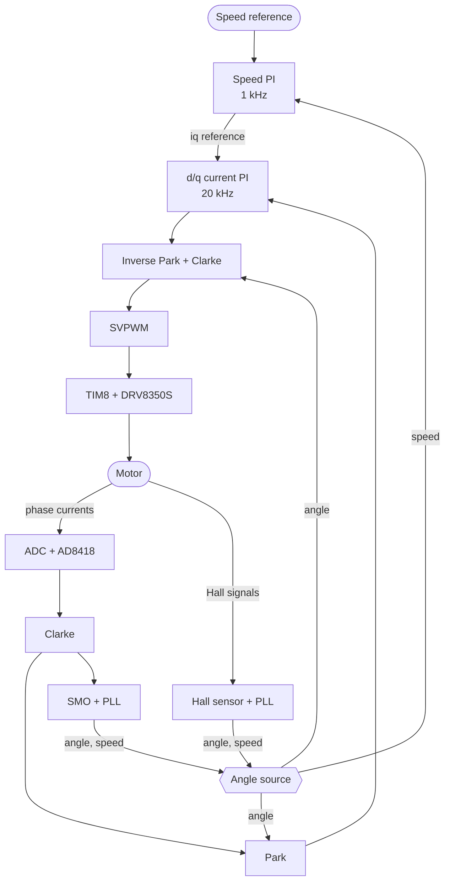
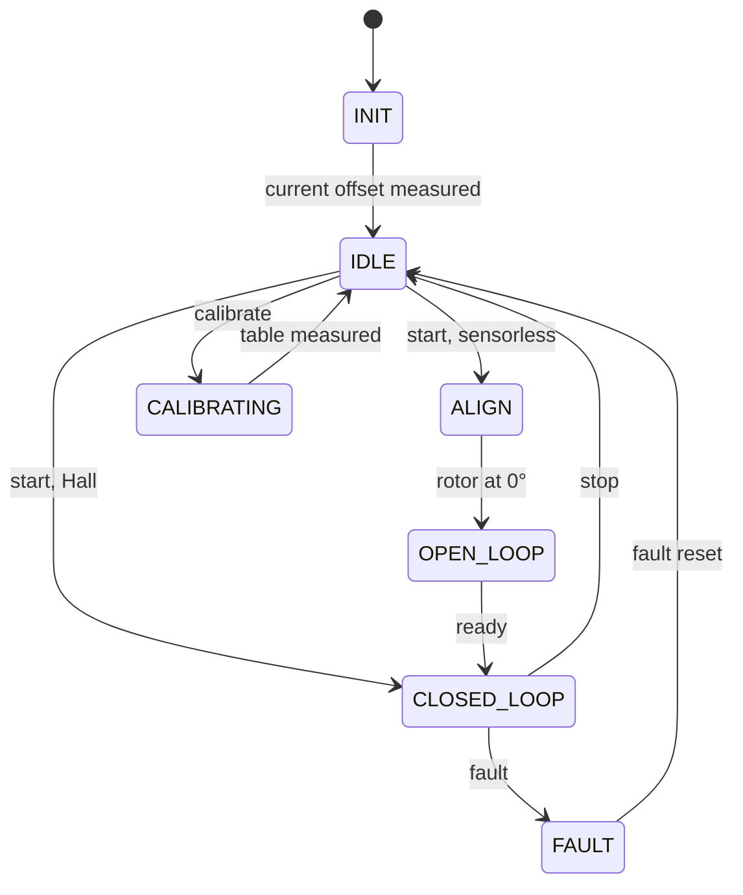

# STM32G4 FOC Motor Drive

Firmware for a three-phase BLDC/PMSM motor drive on the custom STM32G473 [Motor-Control](https://github.com/Sinan-Akbayin/Motor-Control) board. It runs field-oriented control (FOC) at 20 kHz on FreeRTOS. The rotor angle comes from Hall sensors or from a sensorless sliding-mode observer (SMO), and the drive is commanded over CANopen with the CiA 402 drive profile.

> **Hardware note:** the firmware targets one custom board, and its KiCad design is in [Sinan-Akbayin/Motor-Control](https://github.com/Sinan-Akbayin/Motor-Control). You can build the firmware and run the unit tests with no hardware. To run it on another board, you must change the pin, ADC and PWM setup and the motor data. Read [Known limitations](#known-limitations) before you power a motor.

> **Version note:** this README describes the FreeRTOS firmware. `v0.3.0` is the last release on ThreadX. The project moved to FreeRTOS and TinyUSB because ThreadX and USBX are not under the MIT licence.

## Features

- **Motor control:** Clarke and Park transforms, d/q current PI loops and space-vector PWM at 20 kHz, with a speed PI on top at 1 kHz.
- **Two angle sources:** Hall sensors with a calibrated edge table and a PLL, or an SMO with a PLL and an open-loop start.
- **CANopen node:** CiA 402 state machine, profile velocity and profile torque modes, PDOs, SYNC and EMCY, built on CANopenNode over FDCAN1.
- **Protection:** gate-driver fault input, phase over-current, DC-bus over-voltage and under-voltage, and loss of sensorless lock.
- **Live debugging:** [Scrutiny](https://github.com/scrutinydebugger/scrutiny-embedded) over USB CDC with TinyUSB, for watching variables and datalogging from the 20 kHz loop.
- **Testing:** PC unit tests for the control library, CI on GitHub Actions, and Python hardware-in-the-loop (HIL) tests for the real board.

## Hardware

| Item | Value |
|---|---|
| MCU | STM32G473VET6: Cortex-M4F, 170 MHz, 512 KB flash, 128 KB RAM, 24 MHz crystal |
| Gate driver | DRV8350S |
| Power stage | 6 × BSC070N10NS5 N-channel MOSFETs in three half-bridges |
| Current sensing | AD8418 amplifiers (gain 20) on 1.5 mΩ in-line shunts, three phases |
| Voltage sensing | 39 kΩ / 2.2 kΩ dividers on the DC bus and all three phases |
| Supply | LMR38020 buck from the DC bus to 5 V, then AMS1117 to 3.3 V |
| CAN | FDCAN1, ISO1050 isolated transceiver, 500 kbit/s, node-ID 13 |
| USB | Micro-B connector, CDC for Scrutiny |
| Debug | 10-pin SWD header, ST-Link for flashing |
| PCB | 4 copper layers, 100 × 100 mm |
| PWM | TIM8, centre-aligned, 20 kHz |
| Motor | 57BLF02: 24 V, 125 W, 3000 rpm, 4 pole pairs |

The schematic, connector list and full MCU pin table are in [Motor-Control](https://github.com/Sinan-Akbayin/Motor-Control). The firmware's own pin and clock setup is in [docs/PROJECT.md](docs/PROJECT.md#hardware--toolchain) and in the CubeMX project, [stm32g4-foc-motor-drive.ioc](stm32g4-foc-motor-drive.ioc).

One pin assignment differs from the Motor-Control schematic: this firmware reads the Hall sensors with TIM3 on PA6, PA7 and PB0. The Motor-Control schematic routes the Hall connector J2 to PD9, PD8 and PB11, and shows PA6, PA7 and PB0 on the J11 and J9 headers.

## Status

| Area | State |
|---|---|
| Speed control with Hall and sensorless angle | Tested on the board |
| Torque control with Hall angle | Tested on the board |
| CiA 402 state machine, fault reporting, EMCY | Tested on the board |
| PDOs and SYNC | Tested on the board |
| Speed-step test on FreeRTOS | Accepted without recorded numbers |
| Communication-loss reaction | Not done |
| Bus-off recovery | The CAN driver restarts FDCAN, not tested on the board |
| Final EDS file, `0x1010` store parameters | Not done |
| Hall calibration stored in flash | Not done |
| DC-bus sag and regenerative over-voltage control | Not done |

The latest board results are under [HIL tests](#hil-tests).

The speed-loop results below come from the ThreadX firmware of 2026-10-30, not from FreeRTOS. `motor_control/` and [App/Src/isr.cpp](App/Src/isr.cpp) are the same in both versions.

| Test | Result |
|---|---|
| Hall speed step, 1000 → 1300 rpm | 22 ms rise, 22 % overshoot |
| Sensorless speed step, 1000 → 1300 rpm | 22 ms rise, 17.7 % overshoot |

The Hall speed ramp from 1000 to 1500 rpm was measured the same day on an earlier ThreadX build, with the same speed gains: 31 rpm tracking error and 166 ms settling time.

## Known limitations

This is a development project, not a safety-rated drive. Check these points before you power a motor:

- **No motor stop on communication loss:** if the CAN master disappears, nothing stops the motor, and it keeps its last command. The heartbeat consumer is not set up (`0x1016` is empty), `0x6007` does not exist, and RPDOs have no timeout.
- **No return to operational:** a CAN communication error, such as the master's adapter closing, moves the node to pre-operational, and PDOs stop. The node stays there until an NMT start or a reset. An NMT start sent while the error is still active has no lasting effect.
- **No braking:** Quick Stop lets the motor coast.
- **Basic DC-bus protection:** the Monitor task checks the voltage every 10 ms and turns off the PWM outputs above 30 V or below 12 V. Nothing limits regenerative energy, so a fast deceleration can raise the DC-bus voltage. If the MCU starts before the 24 V supply, the under-voltage fault latches and needs a fault reset.
- **No temperature protection:** the board has NTC inputs and the fault codes exist, but the firmware does not read the sensors.
- **Gate driver on its defaults:** the firmware configures SPI2 but never writes the DRV8350S registers. TIM8 adds no dead time, so the dead time comes from the driver's default setting.
- **Hall calibration is not saved:** a calibration run updates the table in RAM only. After a reset the drive goes back to the table built into [App/Src/app.cpp](App/Src/app.cpp).
- **Sensorless limits:** forward only, at 300 rpm or more. Below 200 rpm for 50 ms, the drive reports a fault and turns off the PWM outputs.
- **Current limits:** the software over-current trip is 20 A per phase. The speed PI limits iq to 9 A. In torque mode iq is limited to 5 A, about 0.33 N·m.
- **Torque break-away:** a low torque target may not start the motor, and the level depends on the rest position. On ThreadX it was 60 ‰ or less at two positions and 71 to 80 ‰ at a third. 80 ‰ turned the motor in 8 of 8 starts, but a position that needs more torque cannot be ruled out.
- **`0x6077` reads low during acceleration:** on ThreadX it read about 7 to 12 % under the target while the motor accelerated. The FreeRTOS run reads the same way (mean 74.0 ‰ at a target of 80 ‰). The cause has not been measured, so it may be a reading error or a real current error.

## How it works

### Control loop



The SMO also uses the voltage commanded by the current loop. The id reference is 0. In profile torque mode the speed PI is skipped, and the torque target sets the iq reference directly.

### Timing

| Context | Rate | What it does |
|---|---|---|
| ADC3 interrupt, triggered by TIM8 | 20 kHz | Reads currents and voltages, runs the SMO and PLLs, runs FOC, updates the PWM duty cycles |
| Every 20th ADC3 interrupt | 1 kHz | Runs the speed PI |
| Supervisor task (priority 5) | 1 kHz | Motor state machine, start-up sequences, reference limits |
| CANopen task (priority 4) | 1 kHz | CANopenNode stack, CiA 402 state machine, speed and torque ramps |
| Monitor task (priority 3) | 100 Hz | DC-bus voltage check, status values, LED |
| USB task (priority 2) | On USB events | TinyUSB device stack |
| Scrutiny task (priority 1) | 1 kHz | Scrutiny protocol over USB CDC |

In FreeRTOS a higher number means a higher priority, and all tasks use static memory. The ADC3 and gate-driver fault interrupts sit above the FreeRTOS interrupt mask, so critical sections never delay them.

### Motor states



A fault moves the drive to `FAULT` from any state and turns off the PWM outputs. A fault reset returns to `IDLE`, or to `INIT` if start-up had not finished. A stop returns to `IDLE` from any state except `INIT` and `FAULT`.

- **Hall start:** the motor goes straight to closed loop.
- **Sensorless start:** a back-EMF observer sees nothing at standstill, so the drive first pulls the rotor to 90° and then to 0° with 1 A, for 1 s each. It then spins the field open loop at 2 A up to 500 rpm and gives the SMO time to lock. Next, it lowers iq until the open-loop and SMO angles agree within 0.3 rad (about 17°) or iq reaches 0.1 A. Then it switches to the SMO angle and fades out any angle difference that is left. The speed ramp starts from the actual speed at this hand-over, so a lower target is reached on the normal `0x6084` ramp.
- **Hall calibration:** the drive turns the rotor one mechanical turn forward and one back, in open loop, to measure the angle of each Hall edge. This takes about 10 s.

## Repository layout

```text
App/                  Hardware and timing: interrupts, ADC, Supervisor, Monitor, CANopen bridge
motor_control/        Hardware-free C++20 library: FOC and CiA 402 logic (no HAL, registers or RTOS calls)
canopen/              CANopenNode, its STM32 driver, and the object dictionary in od/
tests/                GoogleTest unit tests for motor_control
tools/hil/            Python HIL tests for the real board
scrutiny-embedded/    Scrutiny target library
tinyusb/              TinyUSB USB stack, only the files this firmware needs
.github/workflows/    CI build and release
cmake/                CMake toolchain files and the CubeMX source list
docs/                 Project notes: architecture, decisions, work log
Core/, Drivers/, Middlewares/
                      STM32CubeMX output, ST drivers, FreeRTOS
```

`motor_control/` never touches hardware, so the same sources build for the target and for the PC. In generated files, edit only between the `USER CODE BEGIN` and `USER CODE END` markers, because CubeMX overwrites everything else.

## Build

You need the Arm GNU Toolchain 14.3 (`arm-none-eabi-gcc`), CMake 3.22 or newer, and Ninja, all on `PATH`. The STM32Cube extension for VS Code installs all three but does not add them to `PATH`, so add its toolchain, CMake and Ninja folders to `PATH` for command-line builds.

```shell
cmake --preset Debug
cmake --build --preset Debug
```

Use the `Release` preset for an optimised build. The output is `build/<preset>/stm32g4-foc-motor-drive.elf`, and the link step prints the memory use. On 2026-10-30 the Release build used 96 of 512 KB flash and 34 of 128 KB RAM.

If the Scrutiny CLI is installed, a post-build step also makes a `*_tagged.elf` file and a `.sfd` file. Flash the tagged ELF to use Scrutiny. Without the CLI, this step is skipped and the build still works.

## Unit tests

The tests run on the PC and need `gcc`, `g++`, CMake and Ninja, but no Arm toolchain. The first `cmake --preset HostTests` downloads GoogleTest 1.17.0, pinned by SHA-256.

```shell
cmake --preset HostTests
cmake --build --preset HostTests
ctest --preset HostTests
```

All 157 tests passed on the PC on 2026-10-30.

## HIL tests

The scripts in [tools/hil/](tools/hil) test a real board over CAN and Scrutiny: the CiA 402 state machine, PDOs and SYNC, and speed-step response. They need `python-can`, `pyserial` and an SLCAN adapter. Set the adapter port in `PORT` in `test_pdo.py` and `test_cia402_v2.py`. Scripts that use Scrutiny also need `scrutinydebugger` 0.16 and a running Scrutiny server. Any test that turns the motor needs the `--motor-ok` flag.

T1 and T9 wait for a board reset. With `--nmt-reset`, the script sends the reset itself:

```shell
python tools/hil/test_cia402_v2.py --tests T1,T9,T2,T3,T7,T8 --nmt-reset
python tools/hil/test_cia402_v2.py --tests T5,T6 --motor-ok
python tools/hil/test_pdo.py --tests D,A,B,C --motor-ok
```

### Latest results

These tests passed on 2026-10-30 on one board with the FreeRTOS firmware, in two runs. Run A used a local Release build, Scrutiny firmware ID `08c84ea7…`. Run B added the tests that need Scrutiny, but its log holds no firmware ID, so its build is not confirmed. The run logs are not in this repository.

| Test | What it checks | Result | Run |
|---|---|---|---|
| T1 | Start-up after an NMT reset | `0x6041` = `0x0250` after 7.5 ms, no fault | A |
| T9 | Controlword `0x06` right after boot-up | First read `0x0231` at 10.5 ms, none during `INIT` | A |
| T2 | Heartbeat period | 999.3 to 1000.5 ms | A |
| T3 | Controlword steps and heartbeat during the current-offset refresh | Each step 4.0 to 4.3 ms in A, 4.1 to 6.0 ms in B, limit 10 ms | A, B |
| T4 | Current offsets | 2045, 2045 and 2046 counts | B |
| T7 | Fault injected through Scrutiny | Statusword, `0x603F`, `0x1001` and EMCY as expected | B |
| T8a to T8c | Fault reset on the rising edge of bit 7 | As expected | B |
| T5 | Sensorless start to 300 rpm | ALIGN → OPEN_LOOP → CLOSED_LOOP, 312 to 319 rpm from 6.5 s | A |
| T6 | Enable again right after T5, with the rotor still coasting: no lock-up | `0x0237` after 3.9 ms, `0x0250` after 4.0 ms | A |
| PDO D | SYNC and TPDO types | One TPDO1 per SYNC, every second one on type 2, none without SYNC | A |
| PDO A | Sensorless profile velocity over RPDO1 | 1004 rpm mean, 1000 → 1500 rpm stays in Operation Enabled | A |
| PDO B | Hall profile velocity over RPDO1 | 1005 rpm mean, 1000 → 1500 rpm stays in Operation Enabled | A |
| PDO C | Hall profile torque over RPDO2, 80 ‰ for 0.45 s | `0x6077` mean 74.0 ‰, limit 65 to 95 ‰ | A |

Each test ran once, except T3, which ran twice. T6 has not been run from rest.

Read these limits with the table:

- T1 and T9 used a software reset, not a power cycle, so the real power-up path is not covered.
- T9 passes almost by design, because `INIT` is already over at the first read. The unit test `ControlwordIsIgnoredDuringInit` covers this case.
- T5 checks the speed only from 6.5 s after the start, because before that the rotor is still on the ramp from the 500 rpm hand-over.
- Timing depends on the PC: `python-can` reads SLCAN byte by byte, so busy Python code in the same process delays reception. The CiA 402 script waits 2 s after connecting to Scrutiny for this reason. A late frame in these tests can be a PC delay, not a firmware delay.

## CI

- [build.yml](.github/workflows/build.yml) runs on every push. It builds Debug and Release, prints the memory use, uploads the `.elf` and `.map` files, and runs the unit tests.
- [release.yml](.github/workflows/release.yml) runs on `v*` tags. It runs the unit tests, builds Release with the Scrutiny CLI, then publishes a GitHub Release with the tagged `.elf`, the `.sfd`, and `.hex` and `.bin` files made from the tagged ELF.

`build.yml` has no Scrutiny CLI, so its ELF files are not tagged for Scrutiny. Release files come from a separate CI build, not from the local build used for the HIL tests, so those results do not directly cover them.

## CANopen interface

The full object list is in [canopen/od/bldc_drive.eds](canopen/od/bldc_drive.eds). [canopen/od/bldc_drive.dbc](canopen/od/bldc_drive.dbc) decodes the PDOs in CAN tools.

To run the motor at 1000 rpm over SDO:

| Step | Object | Value | Meaning |
|---|---|---|---|
| 1 | `0x6060` | `3` | Select profile velocity mode (`4` = profile torque) |
| 2 | `0x2012` | `1` | Select the sensor: `1` = Hall, `0` = sensorless |
| 3 | `0x60FF` | `1000` | Set the target velocity in rpm |
| 4 | `0x6040` | `0x06` → `0x07` → `0x0F` | Shutdown → Switch On → Enable Operation |

Write `0x06` to `0x6040` to stop. The PWM outputs turn off and the motor coasts. To clear a fault, write `0x00`, then `0x80`, then `0x00`.

A state command such as `0x06` written during start-up is not lost. `0x6040` keeps the value, and the drive acts on it when `INIT` ends.

To measure the Hall table, write `4` to `0x2011` while the motor is idle. The motor turns for about 10 s. Wait until `0x2002` shows `IDLE` again before you start it.

Main objects:

| Object | Name | Unit or values |
|---|---|---|
| `0x6040` / `0x6041` | Controlword / Statusword | CiA 402 |
| `0x6060` / `0x6061` | Modes of operation / display | `3` = profile velocity, `4` = profile torque |
| `0x60FF` / `0x606C` | Target velocity / actual velocity | rpm |
| `0x6071` / `0x6077` | Target torque / actual torque | ‰ of `0x6076` (400 mN·m) |
| `0x6083` / `0x6084` | Profile acceleration / deceleration | rpm/s |
| `0x6087` | Torque slope | ‰/s |
| `0x603F` | Error code | CiA 402 |
| `0x2000` / `0x2001` | DC-bus voltage / speed | mV / rpm |
| `0x2002` / `0x2003` | Motor state / fault code | numbers from [state_machine.hpp](motor_control/inc/state_machine.hpp) |
| `0x2010` | Speed reference without a ramp | rpm |
| `0x2011` | Command | `2` = stop, `4` = calibrate Hall |
| `0x2012` | Sensor mode (profile velocity only) | `0` = sensorless, `1` = Hall |

PDOs for node-ID 13:

| PDO | COB-ID | Content |
|---|---|---|
| RPDO1 | `0x20D` | Controlword, target velocity |
| RPDO2 | `0x30D` | Controlword, target torque |
| TPDO1 | `0x18D` | Statusword, actual velocity |
| TPDO2 | `0x28D` | Statusword, actual torque, mode display |

The drive applies RPDOs on receipt and sends TPDOs every 100 ms. For synchronous TPDOs, set `0x1800:02` (TPDO1) or `0x1801:02` (TPDO2) to a value from 1 to 240.

## Licence

The project's own code is under the [MIT licence](LICENSE), © 2026 Can Kandamar. This repository as a whole is not under MIT, because third-party code keeps its own licence:

| Component | Path | Licence |
|---|---|---|
| [CANopenNode](https://github.com/CANopenNode/CANopenNode) | `canopen/CANopenNode/` | Apache-2.0 |
| [CanOpenSTM32](https://github.com/CANopenNode/CanOpenSTM32), adapted | `canopen/CANopenNode_STM32/` | MIT |
| [Scrutiny embedded library](https://github.com/scrutinydebugger/scrutiny-embedded) | `scrutiny-embedded/` | MIT |
| STM32G4 HAL | `Drivers/STM32G4xx_HAL_Driver/` | BSD-3-Clause, see its `LICENSE.txt` |
| CMSIS | `Drivers/CMSIS/` | Apache-2.0, see its `LICENSE.txt` |
| CubeMX code, start-up file, linker script | `Core/`, `startup_stm32g473xx.s`, `STM32G473xx_FLASH.ld` | STMicroelectronics, see each file header |
| FreeRTOS 10.3.1 | `Middlewares/Third_Party/FreeRTOS/` | MIT |
| [TinyUSB](https://github.com/hathach/tinyusb) 0.21.0 | `tinyusb/` | MIT |

## More documentation

- [docs/PROJECT.md](docs/PROJECT.md): architecture, environment, hardware and design decisions
- [canopen/VERSIONS.md](canopen/VERSIONS.md), [tinyusb/VERSIONS.md](tinyusb/VERSIONS.md): versions of the third-party sources
- [Motor-Control](https://github.com/Sinan-Akbayin/Motor-Control): the board design
