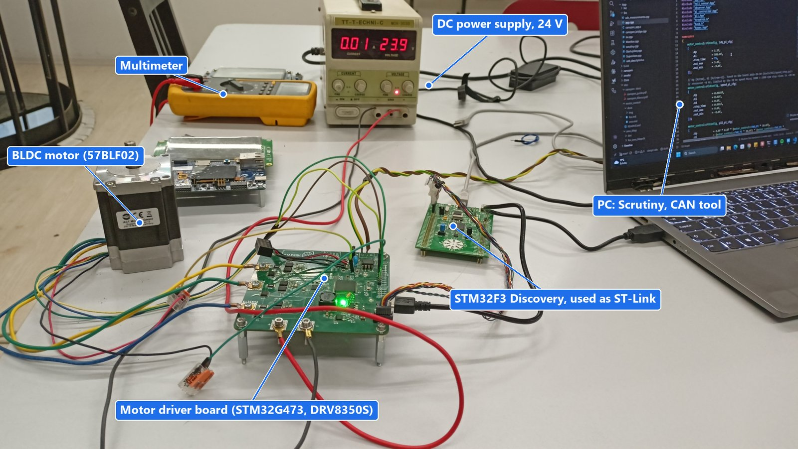
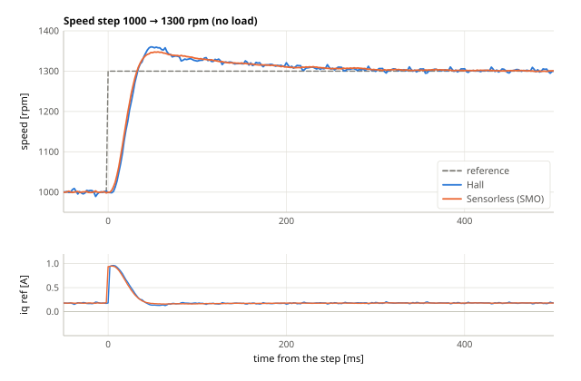
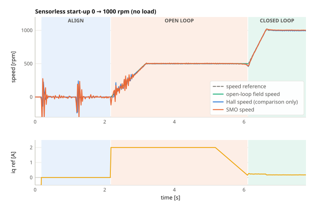
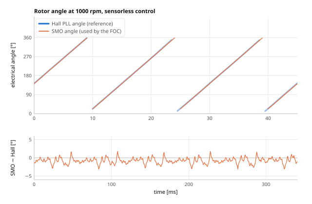
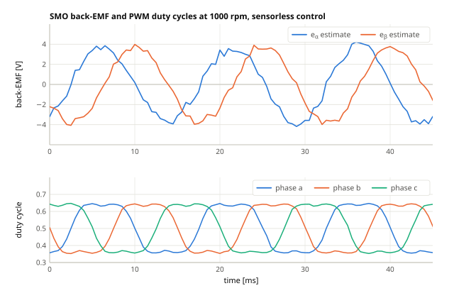
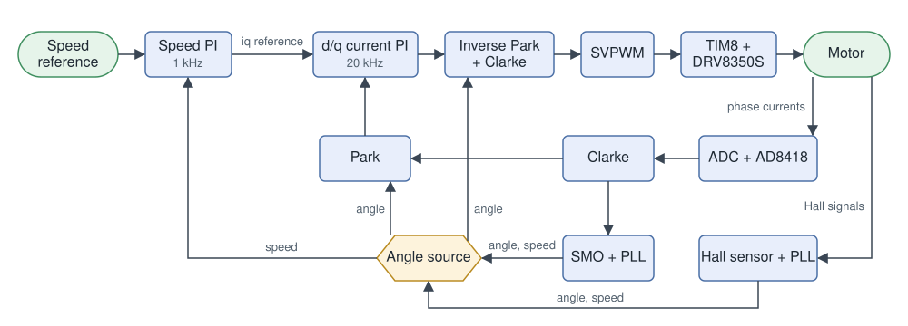
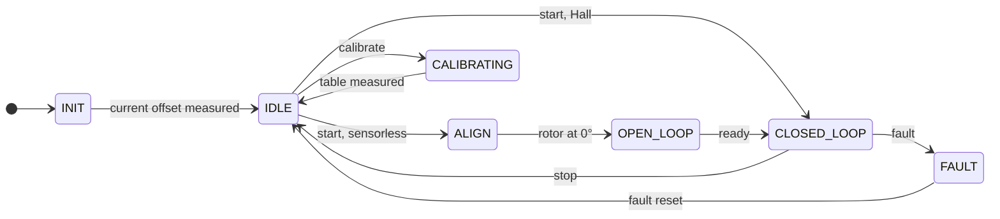

# STM32G4 FOC Motor Drive

[](https://github.com/MCanKandamar/stm32g4-foc-motor-drive/actions/workflows/build.yml)
[](https://github.com/MCanKandamar/stm32g4-foc-motor-drive/releases)
[-blue)](#licence)

Firmware for a three-phase BLDC/PMSM motor drive on the custom STM32G473 [Motor-Control](https://github.com/Sinan-Akbayin/Motor-Control) board. It runs field-oriented control (FOC) at 20 kHz on FreeRTOS. The rotor angle comes from Hall sensors or from a sensorless sliding-mode observer (SMO), and the drive is commanded over CANopen with the CiA 402 drive profile.



> **Hardware note:** the firmware targets one custom board, and its KiCad design is in [Sinan-Akbayin/Motor-Control](https://github.com/Sinan-Akbayin/Motor-Control). You can build the firmware and run the unit tests with no hardware. To run it on another board, you must change the pin, ADC and PWM setup and the motor data. Read [Known limitations](#known-limitations) before you power a motor.

## Results on the board

Measured on 2026-11-03 with the Scrutiny datalogger, which samples the 20 kHz control loop on the board. 24 V supply, no load on the motor shaft. Commands and scripts are in [docs/hil_tests.md](docs/hil_tests.md).

| Test | Hall | Sensorless (SMO) |
|---|---|---|
| Speed step 1000 → 1300 rpm: rise time (10 → 90 %) | 18 ms | 20 ms |
| Overshoot | 20.1 % | 15.9 % |
| Time to stay within 5 % | 246 ms | 180 ms |
| SMO angle against the Hall angle at 1000 rpm | | mean −0.8°, std 0.8°, largest 3.1° (electrical) |



The speed reference jumps from 1000 to 1300 rpm. The speed PI sets the q-axis current reference (iq ref, the torque-producing current), and the speed follows in about 20 ms with both angle sources.



The back-EMF is zero at standstill, so the observer has nothing to measure, and a sensorless start has three steps. ALIGN pulls the rotor to a known angle with a d-axis current, which is not in the plot. OPEN LOOP turns the field at a set speed with 2 A. After the SMO locks, iq is lowered and the drive switches to CLOSED LOOP on the SMO angle. The Hall speed is logged only for comparison. The SMO speed estimate is noisy during ALIGN, but the drive does not use it until the switch.



The FOC runs on the SMO angle here. The Hall angle, from its own PLL, is the reference. The two agree within about 3° electrical. The Hall angle is an estimate too, so this shows how well they agree, not the true error.



Top: the back-EMF that the SMO estimates in the fixed α-β frame, two sine waves a quarter period apart. Their direction gives the rotor angle and their size grows with speed. Bottom: the three PWM duty cycles. Space-vector PWM adds the same offset to all three phases, so each curve has a flat, saddle-like top instead of a pure sine. This lets the drive use more of the DC-bus voltage.

## Features

- **Motor control:** Clarke and Park transforms, d/q current PI loops and space-vector PWM at 20 kHz, with a speed PI on top at 1 kHz.
- **Two angle sources:** Hall sensors with a calibrated edge table and a PLL, or an SMO with a PLL and an open-loop start.
- **CANopen node:** CiA 402 state machine, profile velocity and profile torque modes, PDOs, SYNC and EMCY, built on CANopenNode over FDCAN1. A lost master is detected by heartbeat or RPDO timeout, with a set reaction (`0x6007`).
- **Protection:** gate-driver fault input, phase over-current, DC-bus over-voltage and under-voltage, board over-temperature (85 °C), loss of sensorless lock, an independent watchdog (IWDG, 100 ms) and a check of the FOC interrupt rate.
- **Live debugging:** [Scrutiny](https://github.com/scrutinydebugger/scrutiny-embedded) over USB CDC with TinyUSB, for watching variables and datalogging from the 20 kHz loop.
- **Testing:** 173 PC unit tests for the control library, CI on GitHub Actions, and Python hardware-in-the-loop (HIL) tests for the real board.

## Hardware

| Item | Value |
|---|---|
| MCU | STM32G473VET6: Cortex-M4F, 170 MHz, 512 KB flash, 128 KB RAM, 24 MHz crystal |
| Gate driver | DRV8350S |
| Power stage | 6 × BSC070N10NS5 N-channel MOSFETs in three half-bridges |
| Current sensing | AD8418 amplifiers (gain 20) on 1.5 mΩ in-line shunts, three phases |
| Voltage sensing | 39 kΩ / 2.2 kΩ dividers on the DC bus and all three phases |
| Temperature sensing | 10 kΩ NTC (R24) on PC3 (ADC1_IN9), 10 kΩ to GND. The motor has no sensor |
| Supply | LMR38020 buck from the DC bus to 5 V, then AMS1117 to 3.3 V |
| CAN | FDCAN1, ISO1050 isolated transceiver, 500 kbit/s, node-ID 13 |
| USB | Micro-B connector, CDC for Scrutiny |
| Debug | 10-pin SWD header, ST-Link for flashing |
| PCB | 4 copper layers, 100 × 100 mm |
| PWM | TIM8, centre-aligned, 20 kHz |
| Motor | 57BLF02: 24 V, 125 W, 3000 rpm, 4 pole pairs |

The schematic, connector list and full MCU pin table are in [Motor-Control](https://github.com/Sinan-Akbayin/Motor-Control). The firmware's own pin and clock setup is in [docs/PROJECT.md](docs/PROJECT.md#hardware--toolchain) and in the CubeMX project, [stm32g4-foc-motor-drive.ioc](stm32g4-foc-motor-drive.ioc).

One pin assignment differs from the Motor-Control schematic: this firmware reads the Hall sensors with TIM3 on PA6, PA7 and PB0. The Motor-Control schematic routes the Hall connector J2 to PD9, PD8 and PB11, and shows PA6, PA7 and PB0 on the J11 and J9 headers.

## Status

`v0.5.0` is the latest release. Test details are in [docs/hil_tests.md](docs/hil_tests.md).

| Area | State |
|---|---|
| Speed control with Hall and sensorless angle | Tested on the board, step results above |
| Torque control with Hall angle | Tested on the board |
| CiA 402 state machine, fault reporting, EMCY | Tested on the board |
| PDOs and SYNC | Tested on the board |
| Communication-loss reaction (`0x6007`, heartbeat consumer, RPDO timeout) | Tested on the board, time from a cable pull to motor stop not measured |
| Bus-off recovery | Tested on the board with a CAN_H to CAN_L short, motor off and at 1000 rpm |
| One control owner (CAN or Scrutiny) | Tested on the board |
| Stop on the `0x6084` ramp | Tested on the board over CAN and from Scrutiny, Hall and sensorless |
| IWDG watchdog | Tested on the board: a halted CPU resets, `reset_by_iwdg` shows it |
| FOC interrupt rate check | Tested on the board: an old unoptimised Debug build gives `FOC_RATE_ERROR`, the current build runs at 20 kHz |
| Board over-temperature | Reads 24.9 °C at rest on the board; warm-up and trip not tested |
| DC-bus sag and regenerative over-voltage control | Not done |

## Known limitations

This is a development project, not a safety-rated drive. Check these points before you power a motor:

- **Communication loss needs setup by the master:** the drive sees a silent master only if the master writes `0x1016` or `0x1400:05` and `0x1401:05` after each boot, because these are 0 by default. A CAN error moves the node to pre-operational until an NMT start. Details in [docs/canopen_interface.md](docs/canopen_interface.md#communication-loss).
- **Stopping:** a stop (`0x06`, `0x07`, `0x2011` = `2` or Scrutiny `cmd.stop`) in profile velocity slows the motor down on the `0x6084` ramp to 100 rpm with Hall or to 300 rpm sensorless, then turns off the PWM outputs, and the motor coasts from there. The Hall ramp ends at 100 rpm because the Hall speed estimate is noisy below about 150 rpm. Quick Stop (`0x02`), `0x00`, a fault, a lost master and a stop in torque mode turn off the PWM outputs at once. The drive has no brake resistor, so the energy goes back to the DC bus. At 1000 rpm/s with no load, the bus did not rise.
- **Basic DC-bus protection:** the Monitor task checks the voltage every 10 ms and turns off the PWM outputs above 30 V or below 12 V. Nothing limits regenerative energy, so a fast deceleration can raise the DC-bus voltage. If the MCU starts before the 24 V supply, the under-voltage fault stays off in `INIT` and `IDLE` until the DC bus first reaches 14 V.
- **Board temperature only:** the board NTC is read every 10 ms, and above 85 °C the drive trips with `DRIVER_OVER_TEMP`. Its B value of 3950 is assumed, because the part number is unknown, so the reading may be off by a few °C away from 25 °C. The motor has no sensor, so `MOTOR_OVER_TEMP` is never raised.
- **Gate driver on its defaults:** the firmware configures SPI2 but never writes the DRV8350S registers. TIM8 adds no dead time, so the dead time comes from the driver's default setting. `DRIVER_OVER_CURRENT` is never raised.
- **No stored parameters:** all object dictionary values live in RAM, so the master must write its settings after each boot. `0x1010` and `0x1011` still report that they work on command, but a write changes only RAM (from reading the code, not tested on the board).
- **Hall calibration is not saved:** a calibration run updates the table in RAM only. After a reset the drive goes back to the table built into [App/Src/app.cpp](App/Src/app.cpp).
- **Sensorless limits:** forward only, at 300 rpm or more. Below 200 rpm for 50 ms, the drive reports a fault and turns off the PWM outputs.
- **Current limits:** the software over-current trip is 20 A per phase. The speed PI limits iq to 9 A. In torque mode iq is limited to 5 A, about 0.33 N·m.
- **Torque break-away:** a low torque target may not start the motor, and the level depends on the rest position. On the older ThreadX firmware it was 60 ‰ or less at two positions and 71 to 80 ‰ at a third. 80 ‰ turned the motor in 8 of 8 starts, but a position that needs more torque cannot be ruled out.
- **`0x6077` reads low during acceleration:** about 7 to 12 % under the target while the motor accelerates (mean 74.0 ‰ at a target of 80 ‰ on FreeRTOS). The cause has not been measured, so it may be a reading error or a real current error.

## How it works

### Control loop



The SMO also uses the voltage commanded by the current loop. The id reference is 0. In profile torque mode the speed PI is skipped, and the torque target sets the iq reference directly. The math is explained step by step in [motor_control/README.md](motor_control/README.md), with the [FOC](motor_control/docs/foc.md) and [SMO](motor_control/docs/smo.md) notes.

### Timing

| Context | Rate | What it does |
|---|---|---|
| ADC3 interrupt, triggered by TIM8 | 20 kHz | Reads currents and voltages, runs the SMO and PLLs, runs FOC, updates the PWM duty cycles |
| Every 20th ADC3 interrupt | 1 kHz | Runs the speed PI |
| Supervisor task (priority 5) | 1 kHz | Motor state machine, start-up sequences, reference limits |
| CANopen task (priority 4) | 1 kHz | CANopenNode stack, CiA 402 state machine, speed and torque ramps |
| Monitor task (priority 3) | 100 Hz | DC-bus voltage, board temperature, FOC rate check, watchdog kick, status values, LED |
| USB task (priority 2) | On USB events | TinyUSB device stack |
| Scrutiny task (priority 1) | 1 kHz | Scrutiny protocol over USB CDC |

The ADC3 interrupt comes at the end of the injected sequence (JEOS), after all three currents are converted. In FreeRTOS a higher number means a higher priority, and all tasks use static memory. The ADC3 and gate-driver fault interrupts sit above the FreeRTOS interrupt mask, so critical sections never delay them.

### Motor states



A fault moves the drive to `FAULT` from any state and turns off the PWM outputs. A fault reset returns to `IDLE`, or to `INIT` if start-up had not finished. A stop returns to `IDLE` from any state except `INIT` and `FAULT`.

- **Hall start:** the motor goes straight to closed loop.
- **Sensorless start:** the drive first pulls the rotor to 90° and then to 0° with 1 A, for 1 s each. It then spins the field open loop at 2 A up to 500 rpm and gives the SMO time to lock. Next, it lowers iq until the open-loop and SMO angles agree within 0.3 rad (about 17°) or iq reaches 0.1 A. Then it switches to the SMO angle and fades out any angle difference that is left. The speed ramp starts from the actual speed at this hand-over, so a lower target is reached on the normal `0x6084` ramp.
- **Hall calibration:** the drive turns the rotor one mechanical turn forward and one back, in open loop, to measure the angle of each Hall edge. This takes about 10 s.

## Repository layout

```text
App/                  Hardware and timing: interrupts, ADC, Supervisor, Monitor, CANopen bridge
motor_control/        Hardware-free C++20 library: FOC and CiA 402 logic (no HAL, registers or RTOS calls)
canopen/              CANopenNode, its STM32 driver, and the object dictionary in od/
tests/                GoogleTest unit tests for motor_control
tools/hil/            Python HIL tests and plots for the real board
scrutiny-embedded/    Scrutiny target library
tinyusb/              TinyUSB USB stack, only the files this firmware needs
.github/workflows/    CI build and release
cmake/                CMake toolchain files and the CubeMX source list
docs/                 Guides, test results, architecture and decisions, work log
Core/, Drivers/, Middlewares/
                      STM32CubeMX output, ST drivers, FreeRTOS
```

`motor_control/` never touches hardware, so the same sources build for the target and for the PC. In generated files, edit only between the `USER CODE BEGIN` and `USER CODE END` markers, because CubeMX overwrites everything else.

## Build

You need the Arm GNU Toolchain 14.3 (`arm-none-eabi-gcc`), CMake 3.22 or newer, and Ninja, all on `PATH`. The STM32Cube extension for VS Code installs all three but does not add them to `PATH`, so add its toolchain, CMake and Ninja folders to `PATH` for command-line builds.

```shell
cmake --preset Debug
cmake --build --preset Debug
```

Use the `Release` preset for an optimised build. The output is `build/<preset>/stm32g4-foc-motor-drive.elf`, and the link step prints the memory use. On 2026-11-03 the Debug build used 163.0 KB and the Release build 97.2 KB of the 512 KB flash, and both used 34.5 KB of the 128 KB RAM.

The Debug build runs the motor too: [App/Src/isr.cpp](App/Src/isr.cpp), [App/Src/adc_measurements.cpp](App/Src/adc_measurements.cpp) and `motor_control/` are built with -O2 in Debug, so the 20 kHz interrupt keeps its rate.

If the Scrutiny CLI is installed, a post-build step also makes a `*_tagged.elf` file and a `.sfd` file. Flash the tagged ELF to use Scrutiny. Without the CLI, this step is skipped and the build still works.

## Unit tests

The tests run on the PC and need `gcc`, `g++`, CMake and Ninja, but no Arm toolchain. The first `cmake --preset HostTests` downloads GoogleTest 1.17.0, pinned by SHA-256.

```shell
cmake --preset HostTests
cmake --build --preset HostTests
ctest --preset HostTests
```

All 173 tests passed on the PC on 2026-11-03.

## Hardware tests

Python scripts in [tools/hil/](tools/hil) test a real board over CAN and Scrutiny: the CiA 402 state machine, PDOs and SYNC, communication loss, and the speed and angle responses shown above. Setup, commands and all results are in [docs/hil_tests.md](docs/hil_tests.md).

## CI

- [build.yml](.github/workflows/build.yml) runs on every push. It builds Debug and Release, prints the memory use, uploads the `.elf` and `.map` files, and runs the unit tests.
- [release.yml](.github/workflows/release.yml) runs on `v*` tags. It runs the unit tests, builds Release with the Scrutiny CLI, then publishes a GitHub Release with the tagged `.elf`, the `.sfd`, and `.hex` and `.bin` files made from the tagged ELF.

`build.yml` has no Scrutiny CLI, so its ELF files are not tagged for Scrutiny. Release files come from a separate CI build, not from the local build used for the hardware tests, so those results do not directly cover them.

## CANopen and Scrutiny

To run the motor at 1000 rpm, check that the node is operational (it is after boot; send NMT start after a CAN error), then write over SDO `3` to `0x6060` (profile velocity), `1` to `0x2012` (Hall), `1000` to `0x60FF`, then `0x06`, `0x07` and `0x0F` to `0x6040`. Write `0x06` to stop: the motor slows down on `0x6084`, then the PWM outputs turn off. All objects, PDOs, fault codes and the communication-loss setup are in [docs/canopen_interface.md](docs/canopen_interface.md).

Useful Scrutiny variables:

| Variable | What it shows |
|---|---|
| `meas.speed_rpm_hall_pll`, `meas.speed_rpm_smo` | Speed from the Hall PLL and from the SMO [rpm] |
| `meas.theta_e_rad_pll`, `meas.theta_e_rad_smo` | Electrical angle from the Hall PLL and from the SMO [rad] |
| `meas.idq_ref` | d and q current references [A] |
| `motor_state_machine.motor_state`, `fault` | Motor state and fault code |
| `status.Vdc`, `status.pcb_temp_c` | DC-bus voltage [V] and board temperature [°C] |
| `status.foc_isr_hz` | Measured FOC interrupt rate, 20 000 when right |
| `reset_by_iwdg` | 1 if the last reset came from the watchdog |
| `cmd.control_source` | Who may start the motor: `CANOPEN` (0, default) or `SCRUTINY` (1). A change stops the motor |

## Documentation

- [motor_control/README.md](motor_control/README.md): the control library, its blocks and one control cycle
- [motor_control/docs/foc.md](motor_control/docs/foc.md): field-oriented control, step by step
- [motor_control/docs/smo.md](motor_control/docs/smo.md): the sliding-mode back-EMF observer and the angle PLL
- [docs/canopen.md](docs/canopen.md): a guide to CANopen and CiA 402 for this drive
- [docs/canopen_interface.md](docs/canopen_interface.md): objects, PDOs, fault codes and communication loss
- [docs/hil_tests.md](docs/hil_tests.md): hardware tests and their results
- [docs/PROJECT.md](docs/PROJECT.md): architecture, environment, hardware and design decisions
- [canopen/VERSIONS.md](canopen/VERSIONS.md), [tinyusb/VERSIONS.md](tinyusb/VERSIONS.md): versions of the third-party sources
- [Motor-Control](https://github.com/Sinan-Akbayin/Motor-Control): the board design

## Licence

The project's own code is under the [MIT licence](LICENSE), © 2026 M. Can Kandamar. This repository as a whole is not under MIT, because third-party code keeps its own licence:

| Component | Path | Licence |
|---|---|---|
| [CANopenNode](https://github.com/CANopenNode/CANopenNode) | `canopen/CANopenNode/` | Apache-2.0 |
| [CanOpenSTM32](https://github.com/CANopenNode/CanOpenSTM32), adapted | `canopen/CANopenNode_STM32/` | MIT |
| [Scrutiny embedded library](https://github.com/scrutinydebugger/scrutiny-embedded) | `scrutiny-embedded/` | MIT |
| STM32G4 HAL | `Drivers/STM32G4xx_HAL_Driver/` | BSD-3-Clause, see its `LICENSE.txt` |
| CMSIS | `Drivers/CMSIS/` | Apache-2.0, see its `LICENSE.txt` |
| CubeMX code, start-up file, linker script | `Core/`, `startup_stm32g473xx.s`, `STM32G473xx_FLASH.ld` | STMicroelectronics, see each file header |
| FreeRTOS 10.3.1 | `Middlewares/Third_Party/FreeRTOS/` | MIT |
| [TinyUSB](https://github.com/hathach/tinyusb) 0.21.0 | `tinyusb/` | MIT |

Older code is different: tags `v0.1.0` to `v0.3.0` and their commits include ThreadX and USBX 6.2.0 from ST's X-CUBE-AZRTOS-G4, under the Microsoft Software License Terms for Azure RTOS. Their licence files are in those tags. The current code and `v0.4.0` do not include them, and the MIT licence above does not cover them. The firmware moved to FreeRTOS and TinyUSB after `v0.3.0` for this reason.

## Working with AI agents

This repository uses [agent-lite](https://github.com/mcankandamar/agent-lite), so work continues across sessions and tools:

- [AGENTS.md](AGENTS.md): the rules for AI agents, such as the build commands, what needs the developer's approval and how checks are reported
- [docs/WORK.md](docs/WORK.md): the current state: next steps, finished work with its evidence, dead ends and open questions
- [docs/PROJECT.md](docs/PROJECT.md): architecture and decisions

When told to continue, an agent reads these files and the git log to see where the work stopped.
