# CANopen Guide

*From the CAN frame to controlling a CiA 402 motor drive — with byte-level example frames for every service.*

This guide is written for a first reading; [Section 11.3](#113-the-drive-in-this-repository) lists what is different on the drive in this repository. Each section starts with the problem it solves, then shows how it works and gives example frames. All examples use one drive, **node 5**, on a 500 kbit/s bus.

**Contents**

- [1. The big picture](#1-the-big-picture)
  - [1.1 Four layers, one command](#11-four-layers-one-command)
  - [1.2 Notation used in this guide](#12-notation-used-in-this-guide)
- [2. CAN bus basics](#2-can-bus-basics)
  - [2.1 Physical layer](#21-physical-layer)
  - [2.2 Dominant and recessive bits](#22-dominant-and-recessive-bits)
  - [2.3 Standard frame (11-bit identifier)](#23-standard-frame-11-bit-identifier)
  - [2.4 Extended frame (29-bit identifier)](#24-extended-frame-29-bit-identifier)
  - [2.5 Arbitration](#25-arbitration)
  - [2.6 Bit stuffing, error handling and CAN FD](#26-bit-stuffing-error-handling-and-can-fd)
- [3. CANopen fundamentals](#3-canopen-fundamentals)
  - [3.1 What CANopen adds](#31-what-canopen-adds)
  - [3.2 Object dictionary](#32-object-dictionary)
  - [3.3 COB-ID: how the CAN ID is formed](#33-cob-id-how-the-can-id-is-formed)
- [4. NMT — network management](#4-nmt--network-management)
  - [4.1 NMT state machine](#41-nmt-state-machine)
  - [4.2 NMT command frame](#42-nmt-command-frame)
- [5. Heartbeat and boot-up](#5-heartbeat-and-boot-up)
- [6. SDO — service data object](#6-sdo--service-data-object)
  - [6.1 Request and response](#61-request-and-response)
  - [6.2 Frame layout and command byte](#62-frame-layout-and-command-byte)
  - [6.3 Expedited examples](#63-expedited-examples)
  - [6.4 Abort codes and segmented transfer](#64-abort-codes-and-segmented-transfer)
- [7. PDO — process data object](#7-pdo--process-data-object)
  - [7.1 Why a second way to move data](#71-why-a-second-way-to-move-data)
  - [7.2 Mapping](#72-mapping)
  - [7.3 Transmission types](#73-transmission-types)
  - [7.4 Configuring a PDO by SDO](#74-configuring-a-pdo-by-sdo)
- [8. SYNC and TIME](#8-sync-and-time)
  - [8.1 SYNC — common time base](#81-sync--common-time-base)
  - [8.2 TIME — time stamp](#82-time--time-stamp)
- [9. EMCY — emergency message](#9-emcy--emergency-message)
- [10. CiA 402 drive profile](#10-cia-402-drive-profile)
  - [10.1 Drive state machine](#101-drive-state-machine)
  - [10.2 Controlword and statusword](#102-controlword-and-statusword)
  - [10.3 Modes of operation, units and scaling](#103-modes-of-operation-units-and-scaling)
- [11. End-to-end example: node 5 at 1000 rpm](#11-end-to-end-example-node-5-at-1000-rpm)
  - [11.1 Configuration and NMT start](#111-configuration-and-nmt-start)
  - [11.2 Enabling, running and stopping the drive](#112-enabling-running-and-stopping-the-drive)
  - [11.3 The drive in this repository](#113-the-drive-in-this-repository)
- [12. Quick reference](#12-quick-reference)
- [13. Glossary](#13-glossary)

## 1. The big picture

### 1.1 Four layers, one command

Suppose a PC must tell a motor drive “run at 1000 rpm”. Four separate questions have to be answered on the way, and each layer of this guide answers one of them. The sender goes from top to bottom, the receiver from bottom to top:

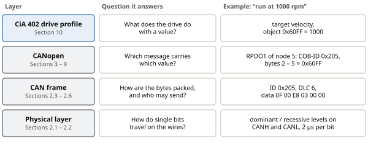

*Figure 1. The layers covered in this guide and how the command “run at 1000 rpm” looks on each of them. Read the guide from the bottom layer up; [Section 11](#11-end-to-end-example-node-5-at-1000-rpm) then follows the full command through all layers.*

The key idea to keep in mind: **a CANopen device is a table of numbered values** (the object dictionary, [Section 3.2](#32-object-dictionary)). Almost everything in CANopen is either writing a value into that table or reading one out of it. The different services (Sections 4–9) are just different ways of doing that — slow and flexible, or fast and pre-arranged.

### 1.2 Notation used in this guide

| Notation | Example | Meaning |
|---|---|---|
| Hexadecimal number | `0x205 = 517` | Prefix 0x. One hex digit is 4 bits, two hex digits are one byte (0x00 … 0xFF). |
| Bit number | bit 0, bit 7 | Bit 0 is the least significant (rightmost) bit. In 0x05 = 0000 0101, bits 0 and 2 are set. |
| CAN frame | `605 [8] 2F 60 60 00 …` | CAN ID 0x605, 8 data bytes, then the bytes in hex, byte 0 first (same format as candump). |
| Object address | `0x6040:00` | Index 0x6040, sub-index 0x00 of the object dictionary ([Section 3.2](#32-object-dictionary)). |
| Bit mask (AND) | `0x37 & 0x0F = 0x07` | Keeps only the bits where the mask has a 1; used to read single flags out of a status value. |

## 2. CAN bus basics

### 2.1 Physical layer

**The problem:** many devices in a machine must exchange data, and a separate cable between every pair would be unmanageable. CAN (Controller Area Network) solves this with a **bus**: all devices, called **nodes**, share the same two wires, **CANH** and **CANL**. Each end of the bus is terminated with a **120 Ω** resistor. Every node has a CAN controller, which produces the bits (FDCAN on the STM32), and a transceiver, which turns them into bus voltages.

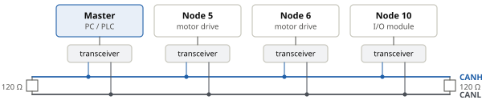

*Figure 2. A CAN network. All nodes connect to the same pair of wires. The master is not special hardware; it is simply the node that sends the commands.*

Sharing two wires has three consequences that shape everything else:

- **Everybody hears everything.** A message has no destination address. Instead its **identifier (ID)** says what it contains, and every node decides from the ID whether the message is useful to it (a **broadcast**).
- **Only one node can talk at a time.** Any node may start sending while the bus is idle; if several start at once, **arbitration** ([Section 2.5](#25-arbitration)) picks one of them without corrupting any data.
- **Errors must be caught on the bus itself.** Every frame carries a checksum (CRC), receivers confirm it with an ACK bit, and a failed frame is resent automatically.

All nodes must use the same **bit rate**. Typical CANopen rates are 125, 250, 500 and 1000 kbit/s; at 500 kbit/s one bit lasts 2 µs.

### 2.2 Dominant and recessive bits

To share one pair of wires safely, CAN uses an unusual way of sending bits, and this choice is what makes collision-free sharing possible. A bit is carried by the **voltage difference** between the two wires, not by the voltage of one wire.

**Dominant (logic 0):** the transceiver actively drives the wires, CANH ≈ 3.5 V and CANL ≈ 1.5 V. **Recessive (logic 1):** nothing drives the wires; the termination pulls both to ≈ 2.5 V, so the difference is ≈ 0 V.

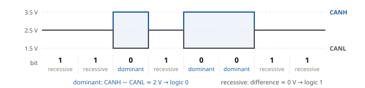

*Figure 3. CANH and CANL voltages. Shaded bits are dominant. Noise that couples into both wires equally does not change the difference.*

Recessive means “not driving”. So if one node sends 1 while another sends 0, the driving node wins and the bus reads **0**: dominant always overrides recessive. The bus therefore behaves as a logical AND of all transmitted bits (**wired-AND**).

Every node also reads the bus back while it transmits. A node that sends 1 but reads 0 knows that someone else is sending. Arbitration ([Section 2.5](#25-arbitration)) and the ACK bit both rely on this one rule.

| Node A sends | Node B sends | Bus reads |
|---|---|---|
| 1 recessive | 1 recessive | 1 |
| 1 recessive | 0 dominant | **0** |
| 0 dominant | 1 recessive | **0** |
| 0 dominant | 0 dominant | 0 |

### 2.3 Standard frame (11-bit identifier)

One CAN message is called a **frame**. Think of it as an envelope: a label saying what is inside (the ID), a note of how many bytes it holds (DLC), up to 8 bytes of content, a checksum, and a receipt slot that receivers stamp (ACK). The data frame of CAN 2.0A looks like this:

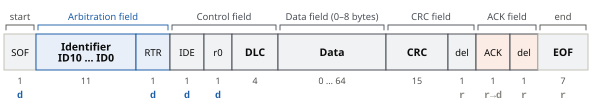

*Figure 4. Standard data frame. Below each field: number of bits and, for fixed bits, the level (d = dominant, r = recessive). Box widths are not to scale.*

| Field | Bits | Purpose |
|---|---|---|
| **SOF** | 1 | Start of frame: one dominant bit after the idle (recessive) bus; all nodes synchronise to its edge. |
| **Identifier** | 11 | Message ID 0x000 … 0x7FF; defines content and priority: **lower ID = higher priority**. |
| **RTR** | 1 | Dominant in a data frame; recessive = remote frame (“send this ID”), not recommended by CiA 301. |
| **IDE, r0** | 1 + 1 | IDE dominant = standard frame, recessive = extended frame. r0 is reserved (dominant). |
| **DLC** | 4 | Data length code: number of data bytes, 0 … 8. |
| **Data** | 0 … 64 | 0 … 8 bytes of payload (the actual content). Everything CANopen defines lives here. |
| **CRC** | 15 + 1 | 15-bit checksum over SOF … data, then a recessive delimiter. |
| **ACK** | 1 + 1 | Sent recessive; every receiver that got the frame correctly drives it dominant. Still 1 → nobody received it, resend. |
| **EOF** | 7 | End of frame: 7 recessive bits, then at least 3 bits of interframe space (IFS). |

> **Good news for firmware:** the program only supplies the **ID, the DLC and the data bytes**. The CAN controller adds SOF, CRC, ACK and EOF by itself and checks them on reception. The other fields are listed so that bus traces and the rest of this section make sense.

> **How long does a frame take?** A standard frame with 8 data bytes has 1 + 11 + 1 + 1 + 1 + 4 + 64 + 15 + 1 + 1 + 1 + 7 = 108 bits, plus 3 bits IFS = 111 bits. At 500 kbit/s this takes 111 × 2 µs ≈ **222 µs**, or up to ≈ 270 µs with stuff bits ([Section 2.6](#26-bit-stuffing-error-handling-and-can-fd)). So the bus carries at most four such frames per millisecond — a budget that matters when many drives share one bus.

### 2.4 Extended frame (29-bit identifier)

You can skip this section on a first reading: CANopen uses the standard frame. It matters only when other protocols share the bus. 11 bits allow just 2048 IDs, so systems that need more (for example J1939 in trucks) use a 29-bit ID, sent as an 11-bit **base ID** followed by an 18-bit **ID extension**:

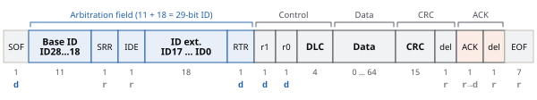

*Figure 5. Extended data frame. A recessive SRR bit takes the place of RTR and IDE is recessive; the real RTR bit follows the 29-bit ID.*

**SRR** (substitute remote request) is always recessive. **IDE = recessive** tells the receivers that 18 more ID bits follow. r1 and r0 are reserved; DLC, data, CRC, ACK and EOF are unchanged.

**Which frame wins if a standard and an extended frame with the same base ID start together?** The first 11 bits are equal. In bit 12 the standard frame sends RTR = **dominant**, the extended frame SRR = **recessive**, so **the standard frame always goes first**. In the same way a data frame (RTR = 0) beats a remote frame (RTR = 1) with the same ID.

### 2.5 Arbitration

**The problem:** two nodes may decide to send at exactly the same moment. CAN resolves this without losing any time or data, using only the dominant/recessive rule of [Section 2.2](#22-dominant-and-recessive-bits). Each node sends SOF and then its ID **most significant bit first**, reading the bus back after every bit. A node that sends 1 (recessive) but reads 0 (dominant) knows a more important message is on the bus: it **stops sending at once**, becomes a receiver and tries again when the bus is idle.

Example: three nodes start together on an idle bus — node A with ID 0x181, node B with 0x182 and node C with 0x601.

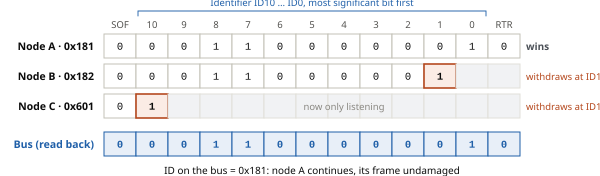

*Figure 6. Bit-wise arbitration. Node C sends 1 in ID10 while the bus is 0 and withdraws. Nodes A and B are equal up to ID1, where B sends 1 and A sends 0: B withdraws. The lowest ID, node A, wins.*

The **numerically lowest ID wins**, because leading zeros are dominant. The ID is therefore also a **priority**: CANopen gives urgent messages small IDs (NMT 0x000, SYNC 0x080) and routine ones large IDs (heartbeat 0x700+). It also follows that two nodes must **never send the same ID**: arbitration would find no winner, and their data fields would collide.

### 2.6 Bit stuffing, error handling and CAN FD

The CAN controller handles the following by itself. They are worth knowing when you read a bus trace or debug a faulty network.

- **Bit stuffing.** Receivers keep their clock aligned by watching bit edges. After 5 equal bits the sender inserts one opposite **stuff bit**, which receivers remove. SOF plus the eleven 0-bits of the NMT ID 0x000 are 12 zeros in a row, so stuff bits follow the 5th and the 10th zero.
- **Error counters and bus-off.** Each node counts its transmit (TEC) and receive (REC) errors. Errors increase the counters, good frames decrease them. Above 127 the node becomes **error passive** (it may no longer disturb other frames); above TEC = 255 it goes **bus-off** and stops sending. A faulty node therefore cannot block the network.
- **CAN FD.** A newer variant: arbitration at the normal rate, the data phase faster (e.g. 2–5 Mbit/s) with **up to 64 bytes**. DLC 9 … 15 then mean 12, 16, 20, 24, 32, 48 and 64 bytes. Classic CANopen (CiA 301), and this guide, use 8-byte frames.

## 3. CANopen fundamentals

### 3.1 What CANopen adds

[Section 2](#2-can-bus-basics) explained how 8 bytes reach every node. It did not say what they mean. Suppose the drive receives ID 0x205 with the data `0F 00 E8 03 00 00`: is that a speed, a position, an error? CAN alone cannot tell. **CANopen** (standard CiA 301) is the agreement that answers this. It fixes which IDs are used for which purpose, how the bytes are arranged, and how a device’s settings are read and written. On top of it, **CiA 402** is the profile for motor drives: it says, for example, that the target velocity is always object 0x60FF.

Every device has a **node ID** from 1 to 127. One node, usually a PC or PLC, is the **master**: it starts, configures and monitors the others. CANopen offers a small set of **services** — message types, each for one kind of job:

| If you want to … | Use | Section |
|---|---|---|
| start, stop or reset the communication of a node | **NMT** | 4 |
| know whether every node is still alive | **Heartbeat** | 5 |
| read or write a setting once, with confirmation | **SDO** | 6 |
| exchange live values (commands, measurements) quickly and repeatedly | **PDO** | 7 |
| make several nodes act at the same instant, or share the time of day | **SYNC**, **TIME** | 8 |
| learn that a device has detected an error | **EMCY** | 9 |

### 3.2 Object dictionary

The **object dictionary (OD)** is the central idea of CANopen. It is a table inside every device that lists all its settings and live values, each at a fixed address — much like the numbered drawers of a cabinet, or the cells of a spreadsheet. The target velocity of a CiA 402 drive, for instance, always sits in the drawer 0x60FF. The address has two parts: a 16-bit **index** (0x0000 … 0xFFFF) selects the object, and an 8-bit **sub-index** (0x00 … 0xFF) selects one field inside it. It is written `0x6040:00`. A single value uses sub-index 0. An object with several fields usually keeps the number of fields in sub-index 0, as the identity object 0x1018 does:

| Entry | Meaning | Type |
|---|---|---|
| `0x1018:00` | number of entries (4) | UNSIGNED8 |
| `0x1018:01` | vendor ID | UNSIGNED32 |
| `0x1018:02` | product code | UNSIGNED32 |
| `0x1018:03` | revision number | UNSIGNED32 |
| `0x1018:04` | serial number | UNSIGNED32 |

Each object also has a **data type** (UNSIGNED8/16/32 = unsigned 8/16/32-bit integer, INTEGER8/16/32 = signed, VISIBLE_STRING = text), an **access type** (RO read-only, RW read-write, WO write-only) and a flag saying whether it may be **mapped into a PDO** ([Section 7](#7-pdo--process-data-object)).

**Little-endian.** A number longer than one byte is sent **least significant byte first**. Index 0x6041 appears on the bus as `41 60`; the 32-bit value 1000 = 0x000003E8 as `E8 03 00 00`. When decoding a frame, reverse the bytes.

The index also tells you who defined the object, because the table is divided into areas:

| Index range | Area | Important objects |
|---|---|---|
| `0x1000 – 0x1FFF` | Communication profile (CiA 301), the same in every CANopen device | 0x1000 device type, 0x1001 error register, 0x1017 heartbeat time, 0x1018 identity, 0x1400/0x1600 RPDO, 0x1800/0x1A00 TPDO |
| `0x2000 – 0x5FFF` | Manufacturer-specific: your own parameters | e.g. in this repository 0x2000 DC-bus voltage, 0x2012 sensor mode |
| `0x6000 – 0x9FFF` | Device profile, the same in every device of one type (CiA 402 for drives) | 0x6040 controlword, 0x6041 statusword, 0x6060 mode, 0x606C actual velocity, 0x60FF target velocity |

### 3.3 COB-ID: how the CAN ID is formed

Every CANopen message needs a CAN ID, and that ID has two jobs: it must say **what kind of message** it is and **which node** it belongs to — and, through arbitration, it also sets the priority. CANopen calls this ID the **COB-ID** (communication object identifier).

In the default scheme (the **predefined connection set**) the 11 bits are split into a 4-bit **function code** for the message type and a 7-bit **node ID**:

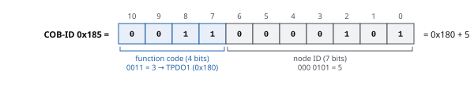

*Figure 7. COB-ID = function code + node ID. The TPDO1 of node 5 is 0x180 + 5 = 0x185.*

So every node automatically gets its own set of IDs and no two nodes collide. In the table, **n** stands for the node ID. The terms in it are introduced in the following sections; return to this table whenever an ID is unclear.

- **T and R are seen from the device:** a TPDO is **transmitted** by the device, an RPDO is **received** by it. The drive’s TPDO1 (0x185) is therefore incoming data for the master.
- **Priority follows the ID:** NMT > SYNC > EMCY > TIME > PDOs > SDOs > heartbeat. Real-time data travels in PDOs, which win against SDO traffic.
- These are defaults; the COB-IDs of PDOs (0x1400 / 0x1800 sub 1), EMCY (0x1014), SYNC (0x1005) and TIME (0x1012) can be changed in the OD.

| Object | Function code | COB-ID | Node 5 | Direction |
|---|---|---|---|---|
| NMT command | `0000` | `0x000` | `0x000` | master → nodes |
| SYNC | `0001` | `0x080` | `0x080` | SYNC producer → all |
| EMCY | `0001` | `0x080 + n` | `0x085` | node → all |
| TIME | `0010` | `0x100` | `0x100` | TIME producer → all |
| TPDO1 / RPDO1 | `0011 / 0100` | `0x180 / 0x200 + n` | `0x185 / 0x205` | node → / → node |
| TPDO2 / RPDO2 | `0101 / 0110` | `0x280 / 0x300 + n` | `0x285 / 0x305` | node → / → node |
| TPDO3 / RPDO3 | `0111 / 1000` | `0x380 / 0x400 + n` | `0x385 / 0x405` | node → / → node |
| TPDO4 / RPDO4 | `1001 / 1010` | `0x480 / 0x500 + n` | `0x485 / 0x505` | node → / → node |
| SDO response (server → client) | `1011` | `0x580 + n` | `0x585` | drive → master |
| SDO request (client → server) | `1100` | `0x600 + n` | `0x605` | master → drive |
| Heartbeat / boot-up | `1110` | `0x700 + n` | `0x705` | node → all |

## 4. NMT — network management

### 4.1 NMT state machine

**The problem:** after power-up a device must be configured — which values to send, how often — before live data starts flowing; otherwise it might send or act on data in the wrong format. CANopen therefore gives every node a small **state machine** (a set of states with defined transitions), and only the master decides when a node moves from “being configured” to “running”.

Think of it as a traffic light for the node’s **communication**:

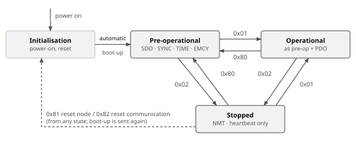

*Figure 8. NMT state machine. Arrow labels are NMT command codes. After initialisation the node sends a boot-up message and enters pre-operational by itself. Some devices can be set to go on to operational by themselves; the drive in this repository does ([Section 11.3](#113-the-drive-in-this-repository)).*

| State | Active services | Typical use |
|---|---|---|
| **Pre-operational** | SDO, SYNC, TIME, EMCY, NMT, heartbeat — no PDO | Configuration: PDO mapping, mode selection |
| **Operational** | all of the above plus PDO | Normal operation, motor control |
| **Stopped** | NMT and heartbeat only — no SDO, PDO or EMCY | Node taken out of the process |

> **NMT does not switch the motor on.** “Operational” only means the node may exchange PDOs. Whether the power stage drives the motor is decided by a second, separate state machine in the drive (CiA 402, [Section 10](#10-cia-402-drive-profile)).

### 4.2 NMT command frame

The master changes a node’s state with an NMT command. It always uses COB-ID 0x000 — the highest priority on the bus — and 2 data bytes. The node does **not confirm** it; the master sees the new state in the node’s next heartbeat ([Section 5](#5-heartbeat-and-boot-up)). After a reset (0x81, 0x82) the node sends its boot-up message again.

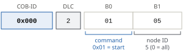

*Figure 9. NMT command: byte 0 is the command, byte 1 the target node ID (0 = all nodes).*

| Command | Meaning | Example | Effect |
|---|---|---|---|
| `0x01` | Start → operational | `000 [2] 01 05` | Start node 5 |
| `0x02` | Stop → stopped | `000 [2] 02 05` | Stop node 5 |
| `0x80` | Enter pre-operational | `000 [2] 80 00` | All nodes to pre-operational |
| `0x81` | Reset node (application + communication) | `000 [2] 81 05` | Node 5 restarts, OD back to power-on values |
| `0x82` | Reset communication | `000 [2] 82 05` | Only 0x1000 … 0x1FFF back to power-on values |

## 5. Heartbeat and boot-up

**The problem:** on a bus, silence is ambiguous — a node that sends nothing may simply have nothing to say, or it may have lost power. The **heartbeat** removes the doubt: every node sends a short “I am alive” message at a fixed interval. The node that sends it is the **producer**; a node that watches for it is a **consumer**.

The producer sends 1 byte on COB-ID 0x700 + node ID every **0x1017 producer heartbeat time** (UNSIGNED16, ms; 0 = off). The byte is the node’s NMT state. The **boot-up** message is the same frame with state 0x00, sent once after every power-up or reset — it tells the master “I have just started and need configuring”.

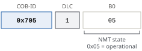

*Figure 10. Heartbeat frame of node 5 in operational state.*

| Byte 0 | State | Node 5 frame |
|---|---|---|
| `0x00` | Boot-up | `705 [1] 00` |
| `0x04` | Stopped | `705 [1] 04` |
| `0x05` | Operational | `705 [1] 05` |
| `0x7F` | Pre-operational | `705 [1] 7F` |

**Heartbeat consumer.** A node watches other nodes through object **0x1016**. Each sub-index (UNSIGNED32) holds the watched node ID in bits 16–23 and the timeout in ms in bits 0–15. If no heartbeat arrives in time, a **heartbeat event** occurs: the node sends an EMCY with error code 0x8130 ([Section 9](#9-emcy--emergency-message)) and changes its NMT state as set in **0x1029:01 error behaviour** (0 = pre-operational, the default; 1 = no change; 2 = stopped).

> **Why this matters for a drive — stop the motor if the master is lost.** If the master crashes or the cable is cut, the drive keeps its last command and would run on at the last speed. To prevent this, the drive (node 5) watches the master (node 1) with a 500 ms timeout: 0x1016:01 = 0x000101F4, written by SDO as `605 [8] 23 16 10 01 F4 01 01 00`. When the master’s heartbeat stops, the drive also applies **0x6007 abort connection option code**: 0 = no action, 1 = fault, 2 = disable voltage, 3 = quick stop. With 1, the drive enters its fault state and stops the motor as its fault reaction 0x605E says ([Section 10.1](#101-drive-state-machine)).

## 6. SDO — service data object

### 6.1 Request and response

**The problem:** the master needs to read or change single settings in a device’s object dictionary — a ramp, a mode, a heartbeat time — usually once, during configuration, and it must know that each change really arrived. The **SDO** does exactly this: it addresses **any** object by index and sub-index and gets an answer every time. It works like a telephone call: one side asks, the other answers.

The side that asks is the **client** (usually the master); the side that owns the object dictionary and answers is the **server** (the drive). Requests use COB-ID **0x600 + node ID** (0x605), responses **0x580 + node ID** (0x585). Every request gets exactly one response — the data, a confirmation or an error (**abort**) — and the client waits for it before sending the next request. SDOs work in pre-operational and operational, not in stopped. Reading the statusword of node 5:

| Direction | Frame | Meaning |
|---|---|---|
| master → | `605 [8] 40 41 60 00 00 00 00 00` | request: read 0x6041:00 |
| ← drive | `585 [8] 4B 41 60 00 40 02 00 00` | response: 2 bytes, 0x6041:00 = 0x0240 |

> **Upload and download are named from the server’s point of view**, as when you download firmware *to* a device. **Download = write** into the device; **upload = read** from the device. The standard and many tools use these words.

### 6.2 Frame layout and command byte

An SDO frame always has 8 bytes: one **command byte** that says what to do, three bytes for the address (index and sub-index), and four bytes for the value. A value of up to 4 bytes therefore fits into one frame; this is called an **expedited transfer**. Example: write 3 (profile velocity mode) into 0x6060:00:

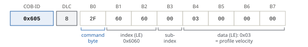

*Figure 11. SDO request “write 3 to 0x6060:00”. Index and data are sent least significant byte first.*

To build such a request by hand: (1) pick the command byte from the table below — here “write 1 byte” = 0x2F; (2) write the index low byte first: 0x6060 → `60 60`; (3) the sub-index: `00`; (4) the value low byte first, padded with zeros to 4 bytes: `03 00 00 00`.

| Operation | Direction | Byte 0 | Meaning |
|---|---|---|---|
| Read request (upload) | client → server | `40` | read index:sub-index; bytes 4–7 = 0 |
| Read response | server → client | `4F / 4B / 47 / 43` | 1 / 2 / 3 / 4 data bytes from byte 4 |
| Write request (download) | client → server | `2F / 2B / 27 / 23` | write 1 / 2 / 3 / 4 data bytes |
| Write response | server → client | `60` | written, OK |
| Abort | either | `80` | bytes 4–7 = 32-bit abort code |

> Where these values come from: bits 7–5 of byte 0 give the transfer type (ccs in requests, scs in responses), bit 4 is reserved, bits 3–2 hold n = the number of **unused** bytes in bytes 4–7, bit 1 is e (expedited), bit 0 is s (size given). 0x2F = 001 0 11 1 1 → download, n = 3 unused bytes, so 1 data byte. 0x4B = 010 0 10 1 1 → upload response, 4 − 2 = 2 data bytes.

### 6.3 Expedited examples

| Action (node 5) | Request 0x605 | Response 0x585 | Note |
|---|---|---|---|
| Read device type 0x1000:00 | `40 00 10 00 00 00 00 00` | `43 00 10 00 92 01 02 00` | 0x00020192: 0x0192 = 402 → CiA 402 servo drive |
| Read statusword 0x6041:00 | `40 41 60 00 00 00 00 00` | `4B 41 60 00 40 02 00 00` | 0x0240 = switch on disabled ([Section 10.2](#102-controlword-and-statusword)) |
| Mode 0x6060:00 = 3 (INTEGER8) | `2F 60 60 00 03 00 00 00` | `60 60 60 00 00 00 00 00` | 1-byte write → 0x2F |
| Heartbeat 0x1017:00 = 100 ms | `2B 17 10 00 64 00 00 00` | `60 17 10 00 00 00 00 00` | 2-byte write → 0x2B |
| Target velocity 0x60FF:00 = 1000 | `23 FF 60 00 E8 03 00 00` | `60 FF 60 00 00 00 00 00` | 4-byte write, little-endian; unit see 10.3 |
| Write to statusword (RO) | `2B 41 60 00 06 00 00 00` | `80 41 60 00 02 00 01 06` | abort 0x06010002 |

### 6.4 Abort codes and segmented transfer

| Abort code | Meaning |
|---|---|
| `0x06020000` | Object does not exist |
| `0x06090011` | Sub-index does not exist |
| `0x06010002` | Write to a read-only object |
| `0x06070010` | Data type or length mismatch |
| `0x06090030` | Value out of range |
| `0x08000022` | Not possible in the present device state |

When a request fails, the server answers with an **abort** (command 0x80) instead of data; the 32-bit code in bytes 4–7 tells why.

A value longer than 4 bytes, such as a text, does not fit into one frame. It is sent as a **segmented transfer**: the first response only gives the total size, then the data follows in pieces of 7 bytes. A toggle bit alternates 0, 1, 0 … so that a lost or repeated piece is detected. Large blocks such as firmware use the faster **block transfer**. The example reads the device name 0x1008 “BLDC-Drive” (10 characters) of a generic drive; the drive in this repository has no 0x1008 and answers with abort 0x06020000.

| Direction | Frame | Meaning |
|---|---|---|
| master → | `605 [8] 40 08 10 00 00 00 00 00` | read 0x1008:00 |
| ← drive | `585 [8] 41 08 10 00 0A 00 00 00` | segmented, 10 bytes in total |
| master → | `605 [8] 60 00 00 00 00 00 00 00` | request segment 1 (toggle 0) |
| ← drive | `585 [8] 00 42 4C 44 43 2D 44 72` | “BLDC-Dr”, more to follow |
| master → | `605 [8] 70 00 00 00 00 00 00 00` | request segment 2 (toggle 1) |
| ← drive | `585 [8] 19 69 76 65 00 00 00 00` | “ive”, 4 bytes unused, last segment |

## 7. PDO — process data object

### 7.1 Why a second way to move data

SDOs are fine for configuration, but too slow for control. A drive that receives a new velocity every millisecond would need a request, a response and 4 address bytes each time. **Process data** — the commands and measurements that change all the time — therefore travels in **PDOs**. The trick: master and drive agree **once, in advance**, which OD values a PDO carries and in which byte positions. After that, a PDO frame contains only the values: no command byte, no address and no answer.

|  | SDO | PDO |
|---|---|---|
| Content | any one object, with its address | up to 8 bytes of pre-arranged values, no address |
| Confirmation | every request is answered | none (broadcast) |
| Typical use | configuration, diagnostics, occasional reads | cyclic commands and feedback |
| Priority / NMT state | low IDs 0x580 … 0x67F; pre-op and operational | higher IDs 0x180 … 0x57F; operational only |

### 7.2 Mapping

The agreement is called the **PDO mapping**, and it is itself stored in the OD, so the master can set it up by SDO. Each PDO has two OD objects: the **communication parameter** says *when* and *with which COB-ID* it is sent, the **mapping parameter** says *what* is inside.

| Object | RPDO1 … 4 | TPDO1 … 4 | Contents |
|---|---|---|---|
| Communication parameter | `0x1400 … 0x1403` | `0x1800 … 0x1803` | sub 1 COB-ID, sub 2 transmission type, sub 3 inhibit time (TPDO only), sub 5 event timer |
| Mapping parameter | `0x1600 … 0x1603` | `0x1A00 … 0x1A03` | sub 0 number of mapped objects, sub 1 … the mapped objects |

Each mapping entry is a 32-bit number that names one OD value: **index (16 bits) | sub-index (8 bits) | length in bits (8 bits)**. So 0x60400010 means “0x6040:00, 0x10 = 16 bits”. The mapped values are packed into the frame one after another, in mapping order:

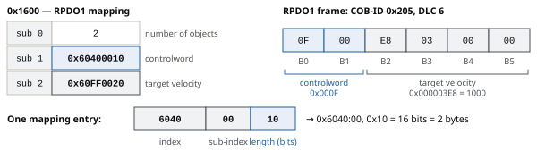

*Figure 12. RPDO1 mapping. Sub 1 places the controlword in bytes 0–1, sub 2 the target velocity in bytes 2–5. When the drive receives 0x205 it writes them to 0x6040 and 0x60FF directly, without any SDO.*

### 7.3 Transmission types

Sub-index 2 of the communication parameter decides when a TPDO is sent and when a received RPDO takes effect. There are two families. **Synchronous** PDOs are tied to the SYNC message ([Section 8.1](#81-sync--common-time-base)): they are sent or applied at the common tick, so all nodes act together. **Event-driven** PDOs are sent when something happens — a value changes or a timer expires — and are applied as soon as they arrive.

| Value | TPDO (device sends) | RPDO (device receives) |
|---|---|---|
| `0x00` | Synchronous, acyclic: sent after the next SYNC, but only when an event (e.g. a value change) has occurred | Synchronous: applied at the next SYNC |
| `0x01 … 0xF0` | Synchronous, cyclic: sent after every n-th SYNC (1 = every SYNC) | Synchronous: applied at the next SYNC |
| `0xFC / 0xFD` | Remote-request only (synchronous / event); not recommended | — |
| `0xFE` | Event-driven; the event is **manufacturer-specific** (see the device manual), typically a change of a mapped value, plus the event timer | Asynchronous: applied on reception |
| `0xFF` | Event-driven; the event is defined by the **device or application profile** (e.g. CiA 402). Without such a definition it behaves like 0xFE | Asynchronous: applied on reception |

> For 0xFE / 0xFF the **event timer** (sub 5, ms; 0 = off) also sends the TPDO periodically, even if nothing changed, and the **inhibit time** (sub 3, unit 100 µs) sets the minimum gap between two transmissions, so a fast-changing value cannot flood the bus. Many devices treat 0xFE and 0xFF identically.

### 7.4 Configuring a PDO by SDO

The mapping is changed in pre-operational state with ordinary SDO writes, in a fixed order: first **switch the PDO off** (bit 31 of its COB-ID), so that a half-written mapping is never used, then rewrite the entries, then switch it on again. Each request is confirmed by a `585 [8] 60 …` response.

| # | Request 0x605 | Effect |
|---|---|---|
| 1 | `23 00 14 01 05 02 00 80` | 0x1400:01 = 0x80000205: bit 31 = 1 disables RPDO1 |
| 2 | `2F 00 16 00 00 00 00 00` | 0x1600:00 = 0: clear the mapping |
| 3 | `23 00 16 01 10 00 40 60` | 0x1600:01 = 0x60400010: controlword, 16 bits |
| 4 | `23 00 16 02 20 00 FF 60` | 0x1600:02 = 0x60FF0020: target velocity, 32 bits |
| 5 | `2F 00 16 00 02 00 00 00` | 0x1600:00 = 2: two objects mapped |
| 6 | `2F 00 14 02 FF 00 00 00` | 0x1400:02 = 0xFF: apply on reception |
| 7 | `23 00 14 01 05 02 00 00` | 0x1400:01 = 0x00000205: enable RPDO1 again |

TPDO1 is set up the same way through 0x1800 / 0x1A00 with **statusword (0x60410010)** and **actual velocity (0x606C0020)**, transmission type 0xFF and a 10 ms event timer (`605 [8] 2B 00 18 05 0A 00 00 00`): the drive then sends TPDO1 on every change and at least every 10 ms. Decoded PDO frames follow in [Sections 8.1](#81-sync--common-time-base) and 11.

## 8. SYNC and TIME

### 8.1 SYNC — common time base

**The problem:** with event-driven PDOs every drive measures and acts at its own moment. For coordinated motion — the axes of a robot arm, for example — all drives must sample their position at the same instant and apply new commands at the same instant. The master therefore sends a periodic **SYNC** message as a common tick: COB-ID **0x080**, no data (DLC 0). The node that sends it is the SYNC **producer**; its period is set in **0x1006 communication cycle period** (µs).

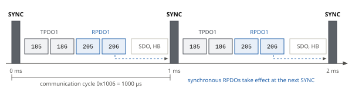

*Figure 13. A 1 ms SYNC cycle. After each SYNC, TPDOs with transmission type 1 (nodes 5 and 6) report their values, the master sends new commands as RPDOs, and the drives apply them together at the next SYNC. SDO and heartbeat use the remaining time.*

| Frame | Meaning |
|---|---|
| `080 [0]` | SYNC, every 1000 µs |
| `185 [6] 37 02 E8 03 00 00` | Node 5 TPDO1 (0x1800:02 = 1): state and velocity at this SYNC |
| `186 [6] 37 02 F4 01 00 00` | Node 6 TPDO1: velocity 500 |
| `205 [6] 0F 00 D0 07 00 00` | Node 5 RPDO1 (0x1400:02 = 1): target 2000, applied at the next SYNC |

> If 0x1019 (synchronous counter overflow) is greater than 1, SYNC carries a 1-byte counter (`080 [1] 07`) for schedules such as “every 4th SYNC”. The cyclic synchronous modes of CiA 402 ([Section 10.3](#103-modes-of-operation-units-and-scaling)) are built on this cycle.

### 8.2 TIME — time stamp

SYNC says *when* to act; TIME says *what time it is*, so that log entries and error records from different nodes carry the same clock. The TIME producer sends the time of day on COB-ID **0x100** (set in **0x1012**: bit 31 = consumer, bit 30 = producer). The 6 data bytes are a TIME_OF_DAY value: bytes 0–3 are the **milliseconds after midnight** (28 bits used), bytes 4–5 the **days since 1 January 1984**, both little-endian. TIME is not confirmed and is usually sent rarely, e.g. once per second.

| Frame | Decoded |
|---|---|
| `100 [6] 40 A5 AE 02 13 3D` | 0x02AEA540 = 45 000 000 ms = 12:30:00.000; 0x3D13 = 15 635 days → 22 October 2026 |

## 9. EMCY — emergency message

**The problem:** the master cannot keep polling every device for errors. Instead a device **reports** its errors itself with an EMCY (emergency) message on COB-ID **0x080 + node ID** (0x085). It sends one each time an error **occurs** and each time an error is **cleared**; when no error is left it sends error code 0x0000. EMCY is a notification, not a command: it is sent once, not repeated and not confirmed, and only in pre-operational and operational. The device also keeps an error history in **0x1003**; **0x1015** (inhibit time, 100 µs) limits how often EMCY can be sent.

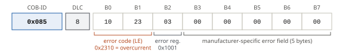

*Figure 14. EMCY frame: bytes 0–1 error code (least significant byte first), byte 2 error register (copy of 0x1001), bytes 3–7 manufacturer-specific error field.*

The frame carries the error twice, at two levels of detail: the 16-bit **error code** names the exact error, the 8-bit **error register** (object 0x1001) only marks its category with one bit per category.

| Error code | Meaning (CiA 301 / 402) |
|---|---|
| `0x0000` | No error / error reset |
| `0x2310` | Continuous overcurrent |
| `0x3210` | DC-link overvoltage |
| `0x3220` | DC-link undervoltage |
| `0x4310` | Drive overtemperature |
| `0x8130` | Heartbeat / life guard error |
| `0x8140` | Recovered from bus-off |

| Bit | Error register 0x1001 |
|---|---|
| 0 | Generic error (set with any error) |
| 1 | Current |
| 2 | Voltage |
| 3 | Temperature |
| 4 | Communication |
| 5 | Device profile specific |
| 7 | Manufacturer-specific |

> **Example — overcurrent.** `085 [8] 10 23 03 00 00 00 00 00`: error code 0x2310, error register 0x03 = bit 0 (generic) + bit 1 (current). A CiA 402 drive also stores the code in **0x603F error code**, runs its fault reaction and enters the fault state; TPDO1 shows statusword 0x0208. After the fault reset ([Section 10.1](#101-drive-state-machine)) the drive sends `085 [8] 00 00 00 00 00 00 00 00`. The EMCY itself does not change the NMT state; for communication errors that is set by 0x1029.

## 10. CiA 402 drive profile

### 10.1 Drive state machine

Sections 3–9 explained how values get into and out of a device. CiA 402 says **which** values a motor drive has and how to use them. Its centre is a second state machine. NMT ([Section 4](#4-nmt--network-management)) decides whether the node may **communicate**; the CiA 402 state machine decides whether the **power stage** — the transistors that put voltage on the motor — may be switched on. A drive only turns the motor when **both** are in the right state: NMT operational *and* CiA 402 operation enabled.

Power is switched on step by step, as on a machine tool: main switch, then enable, then run. The master requests each step by writing the **controlword 0x6040**; the drive reports the state it actually reached in the **statusword 0x6041**. The master should check the statusword before sending the next step.

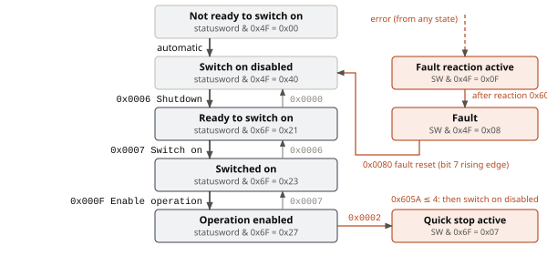

*Figure 15. CiA 402 state machine (simplified). Black arrows: the path to operation enabled with the required controlword. Grey arrows: the way back. Each box shows the masked statusword value (see [Section 10.2](#102-controlword-and-statusword)).*

**How the drive stops is configurable** and differs between drives. Two words are needed for it: a **ramp** is a controlled reduction of speed at a set deceleration; **coasting** means the power stage is switched off and the motor runs down freely.

Check these objects and the manufacturer defaults before you rely on a stop:

| Object | Used when | Typical values |
|---|---|---|
| `0x605E` fault reaction option code | a fault occurs (fault reaction active) | 0 power stage off, motor coasts; 1 slow-down ramp; 2 quick-stop ramp; 3 current limit; 4 voltage limit |
| `0x605A` quick stop option code | controlword 0x0002 (quick stop) | 0 coast; 1 / 2 slow-down / quick-stop ramp, then switch on disabled; 5 / 6 same, but stay in quick stop active |
| `0x605B / 0x605C` shutdown / disable operation option code | controlword 0x0006 / 0x0007 from operation enabled | 0 power stage off at once; 1 ramp down first |
| `0x6007` abort connection option code | communication loss (heartbeat, bus-off) | 0 nothing; 1 fault; 2 disable voltage; 3 quick stop |

A **fault reset** is the **rising edge** of controlword bit 7, i.e. the change of that bit from 0 to 1: write 0x0080 after any value with bit 7 = 0. If the cause is gone, the drive returns to switch on disabled and the sequence 0x0006 → 0x0007 → 0x000F starts again.

### 10.2 Controlword and statusword

Both are 16-bit values in which each bit has its own meaning. The controlword bits are the master’s requests; the statusword bits are the drive’s report.

| Bit | Controlword 0x6040 (master → drive) | Statusword 0x6041 (drive → master) |
|---|---|---|
| 0 | Switch on | Ready to switch on |
| 1 | Enable voltage | Switched on |
| 2 | Quick stop (0 = quick stop active) | Operation enabled |
| 3 | Enable operation | Fault |
| 4 – 6 | Mode-specific (e.g. new set-point in profile position) | 4 voltage enabled, 5 quick stop, 6 switch on disabled |
| 7 | Fault reset (rising edge) | Warning |
| 8 | Halt (1 = stop with the profile deceleration) | Manufacturer-specific |
| 9 – 15 | Mode- / manufacturer-specific | 9 remote, 10 target reached, 11 internal limit active, 12–13 mode-specific |

**Reading the statusword.** The state is encoded only in bits 0–3, 5 and 6; the other bits carry extra information. To find the state, keep the state bits with a mask ([Section 1.2](#12-notation-used-in-this-guide)) and compare the result with the figure. Example: TPDO1 reports `0x0637 = 0000 0110 0011 0111` (bits 0, 1, 2, 4, 5, 9, 10 set). `0x0637 & 0x006F = 0x0027` → operation enabled; bit 10, which the mask removed, separately says the target is reached.

> In not ready, switch on disabled, fault and fault reaction active, bit 5 has no meaning, so these states are tested with the mask 0x004F, as in the figure. The statusword 0x0240 from [Section 6](#6-sdo--service-data-object) gives 0x0240 & 0x4F = 0x40: switch on disabled.

### 10.3 Modes of operation, units and scaling

The **mode of operation** decides what the drive controls. It is selected in **0x6060** (INTEGER8) and read back from **0x6061**. In the **profile** modes the master sends only the target, and the drive plans the motion itself (for example a speed ramp); in the **cyclic synchronous** modes the master sends a new set-point every SYNC cycle and plans the motion itself. Codes: 1 = profile position, 3 = profile velocity, 4 = profile torque, 6 = homing, 8 / 9 / 10 = cyclic synchronous position / velocity / torque. Profile velocity uses the target **0x60FF** (INTEGER32), the ramps **0x6083** / **0x6084** (UNSIGNED32) and reports **0x606C**. Profile torque uses **0x6071** and reports **0x6077**, both in per mille (0.1 %) of the rated torque 0x6076.

**Units.** “1000” in 0x60FF is not automatically 1000 rpm. CiA 402 leaves the unit to the drive: 0x60FF and 0x606C are in **user-defined velocity units**, which the drive converts to its internal unit (usually encoder increments per second) with the factor group — gear ratio 0x6091, feed constant 0x6092 or velocity factor 0x6096. **0x60A9 SI unit velocity** states the unit in use. The ramps 0x6083 / 0x6084 are in velocity units per second (0x60AA SI unit acceleration). Drives differ — rpm, 0.1 rpm and increments/s are all common — so check the manual before sending a speed.

The same speed, 1000 rpm, under three common scalings:

| Drive scaling | 1000 rpm in 0x60FF | Bytes on the bus |
|---|---|---|
| 1 unit = 1 rpm (used in this guide) | `1000 = 0x000003E8` | `E8 03 00 00` |
| 1 unit = 0.1 rpm | `10000 = 0x00002710` | `10 27 00 00` |
| increments/s, 4096 counts per revolution | `1000 × 4096 / 60 ≈ 68267 = 0x00010AAB` | `AB 0A 01 00` |

## 11. End-to-end example: node 5 at 1000 rpm

This section follows the command from [Section 1](#1-the-big-picture) through every service. It has three phases: configure the drive by SDO while it is pre-operational, start its communication with NMT, then switch on the power stage and run the motor with PDOs. Assumptions: PDOs mapped as in [Section 7.4](#74-configuring-a-pdo-by-sdo); scaling 1 unit = 1 rpm and 1 rpm/s; fault reaction 0x605E = 2 (quick-stop ramp).

### 11.1 Configuration and NMT start

| # | Direction | Frame | Meaning |
|---|---|---|---|
| **Power-up — NMT pre-operational** |  |  |  |
| 1 | ← drive | `705 [1] 00` | Boot-up: node 5 is in pre-operational |
| **Configuration by SDO** |  |  |  |
| 2 | master → | `605 [8] 2B 17 10 00 64 00 00 00` | 0x1017 = 100 ms heartbeat |
| 3 | ← drive | `585 [8] 60 17 10 00 00 00 00 00` | Confirmed; steps 4–6 are confirmed the same way |
| 4 | master → | `605 [8] 2F 60 60 00 03 00 00 00` | 0x6060 = 3, profile velocity |
| 5 | master → | `605 [8] 23 83 60 00 F4 01 00 00` | 0x6083 acceleration = 500 rpm/s |
| 6 | master → | `605 [8] 23 84 60 00 F4 01 00 00` | 0x6084 deceleration = 500 rpm/s |
| **NMT start — PDOs begin to flow** |  |  |  |
| 7 | master → | `000 [2] 01 05` | Node 5 to operational |
| 8 | ← drive | `705 [1] 05` | Heartbeat every 100 ms: operational |
| 9 | ← drive | `185 [6] 40 02 00 00 00 00` | Statusword 0x0240: switch on disabled, velocity 0 — communication runs, power stage still off |

### 11.2 Enabling, running and stopping the drive

From here on the master only sends RPDO1 (controlword and target) and watches TPDO1 (statusword and actual velocity). Each controlword step is sent only after the statusword confirms the previous one.

| # | Direction | Frame | Meaning |
|---|---|---|---|
| **CiA 402 state machine** |  |  |  |
| 10 | master → | `205 [6] 06 00 00 00 00 00` | Controlword 0x0006 shutdown, target 0 |
| 11 | ← drive | `185 [6] 21 02 00 00 00 00` | 0x0221 & 0x6F = 0x21: ready to switch on |
| 12 | master → | `205 [6] 07 00 00 00 00 00` | 0x0007 switch on |
| 13 | ← drive | `185 [6] 33 02 00 00 00 00` | 0x0233 → 0x23: switched on (bit 4: voltage enabled) |
| 14 | master → | `205 [6] 0F 00 00 00 00 00` | 0x000F enable operation: current control active, target 0 |
| 15 | ← drive | `185 [6] 37 06 00 00 00 00` | 0x0637 → 0x27: operation enabled, target (0) reached |
| **Run** |  |  |  |
| 16 | master → | `205 [6] 0F 00 E8 03 00 00` | Target velocity 1000 rpm |
| 17 | ← drive | `185 [6] 37 02 F4 01 00 00` | After 1 s: 500 rpm, bit 10 = 0 (on the ramp) |
| 18 | ← drive | `185 [6] 37 06 E8 03 00 00` | After 2 s: 1000 rpm, bit 10 = 1 (target reached) |
| **Stop** |  |  |  |
| 19 | master → | `205 [6] 0F 00 00 00 00 00` | Target 0: decelerate at 500 rpm/s |
| 20 | master → | `205 [6] 06 00 00 00 00 00` | Once stopped, shutdown: power stage off (ready to switch on) |

> **If a fault occurs** — for example an overcurrent after step 18 — the drive sends `085 [8] 10 23 03 00 00 00 00 00` (EMCY), brakes on the quick-stop ramp (0x605E = 2) and then reports `185 [6] 08 02 00 00 00 00` (0x0208 & 0x4F = 0x08: fault, power stage off). After removing the cause the master sends `205 [6] 80 00 00 00 00 00` (fault reset). The drive answers with `085 [8] 00 00 …`, returns to switch on disabled, and the sequence restarts at step 10.

### 11.3 The drive in this repository

The examples above use a generic drive, node 5. The firmware in this repository follows the same rules, with these differences. They come from the object dictionary [`canopen/od/OD.c`](../canopen/od/OD.c) and the CiA 402 code in [`App/Src/canopen_bridge.cpp`](../App/Src/canopen_bridge.cpp) and [`motor_control/src/cia402.cpp`](../motor_control/src/cia402.cpp).

| Topic | This drive |
|---|---|
| Node ID, bit rate | Node 13 (0x0D), 500 kbit/s. The IDs are therefore `0x18D` (TPDO1), `0x20D` (RPDO1), `0x58D` / `0x60D` (SDO), `0x08D` (EMCY) and `0x70D` (heartbeat). |
| NMT start-up | After the boot-up message the node goes to **operational by itself**; the master does not have to send NMT start. A communication error, such as a heartbeat consumer timeout, sets bit 4 of 0x1001 and moves the node to pre-operational. The OD has no 0x1029. |
| Heartbeat | 0x1017 = 1000 ms. 0x1016 is empty (all 0), so the drive watches no master until the master writes it. |
| Default PDOs | RPDO1 (0x20D): controlword + target velocity 0x60FF, as in [Section 7.2](#72-mapping). RPDO2 (0x30D): controlword + target torque 0x6071. TPDO1 (0x18D): statusword + actual velocity 0x606C. TPDO2 (0x28D): statusword + actual torque 0x6077 + mode display 0x6061. All use transmission type 0xFE; the TPDOs also have a 100 ms event timer. PDOs 3 and 4 are off. |
| Modes | 0x6060 = 3 (profile velocity, the default) or 4 (profile torque). Other values give abort 0x06090030; a change while operation enabled gives 0x08000022. Profile torque always uses the Hall sensors. |
| Units | 0x60FF and 0x606C in rpm, 0x6083 / 0x6084 in rpm/s (default 1000). 0x6071 and 0x6077 in per mille of 0x6076 = 400 mN·m, with the torque slope 0x6087 in per mille per second (default 1000). The speed is limited to ±3560 rpm, the torque target to the value that gives 5 A (about 825 per mille). |
| Stopping | The OD has no 0x605A, 0x605B, 0x605C or 0x605E. Phase overcurrent and gate-driver (nFAULT) faults turn off the PWM outputs in the interrupt, other faults within the next 1 ms Supervisor cycle; there is no fault reaction active state. Quick stop, shutdown and disable operation also turn the power stage off, so the motor **coasts**; there is no braking ramp. 0x6007 defaults to 1 (fault). |
| Statusword | Bit 4 says that the DC-bus voltage is within its limits; bit 9 (remote) is always set. In profile velocity, bit 10 (target reached) means that the speed ramp has reached the target and the speed is within 30 rpm of it and bit 12 means speed below 10 rpm. In switched on the power stage stays off and the drive measures the current-sensor offsets; the motor starts at enable operation. |
| EMCY | Error codes come from `cia402_error_code`, e.g. 0x2310 phase overcurrent, 0x3210 / 0x3220 DC-link overvoltage / undervoltage, 0x4210 board overtemperature, 0x5000 gate-driver fault, 0x8100 communication lost, 0xFF01 sensorless lock lost. For these motor faults the error register is **0x81** (bit 0 generic + bit 7 manufacturer-specific), and byte 3 holds 0x40 + the internal fault number. The over-current example is therefore `08D [8] 10 23 81 42 00 00 00 00`. |
| Other objects | No device name 0x1008. Manufacturer objects: 0x2000 DC-bus voltage [mV], 0x2001 speed [rpm], 0x2002 motor state, 0x2003 fault code, 0x2010 speed reference without ramp [rpm], 0x2011 command, 0x2012 sensor mode (0 sensorless, 1 Hall). |

## 12. Quick reference

| Service | COB-ID | DLC | Data layout | Example (node 5) |
|---|---|---|---|---|
| **NMT** | `0x000` | 2 | byte 0 command (01 start, 02 stop, 80 pre-op, 81/82 reset), byte 1 node ID | `000 [2] 01 05` |
| **SYNC** | `0x080` | 0 (1) | no data (optional counter) | `080 [0]` |
| **EMCY** | `0x080 + n` | 8 | bytes 0–1 error code, byte 2 error register, bytes 3–7 manufacturer | `085 [8] 10 23 03 00 …` |
| **TIME** | `0x100` | 6 | bytes 0–3 ms after midnight, bytes 4–5 days since 1984-01-01 | `100 [6] 40 A5 AE 02 13 3D` |
| **TPDO1** | `0x180 + n` | 0–8 | as mapped in 0x1A00 | `185 [6] 37 02 E8 03 00 00` |
| **RPDO1** | `0x200 + n` | 0–8 | as mapped in 0x1600 | `205 [6] 0F 00 E8 03 00 00` |
| **SDO request** | `0x600 + n` | 8 | byte 0 command, 1–2 index, 3 sub-index, 4–7 data | `605 [8] 40 41 60 00 …` |
| **SDO response** | `0x580 + n` | 8 | same layout | `585 [8] 4B 41 60 00 40 02 …` |
| **Heartbeat** | `0x700 + n` | 1 | byte 0 NMT state (00 boot-up, 04, 05, 7F) | `705 [1] 05` |

| CiA 402 object | Name | Type | Use |
|---|---|---|---|
| `0x6040 / 0x6041` | Controlword / statusword | U16 | Drive state machine |
| `0x6060 / 0x6061` | Modes of operation / display | I8 | 3 = profile velocity, 4 = profile torque |
| `0x60FF / 0x606C` | Target / actual velocity | I32 | User-defined velocity units (0x60A9) |
| `0x6083 / 0x6084` | Profile acceleration / deceleration | U32 | Velocity units per second |
| `0x6071 / 0x6077` | Target / actual torque | I16 | Per mille of rated torque 0x6076 |
| `0x605A / 0x605E` | Quick stop / fault reaction option code | I16 | How the drive stops |
| `0x603F` | Error code | U16 | Last error (same code as EMCY) |
| `0x6007` | Abort connection option code | I16 | Reaction to a communication loss |

## 13. Glossary

| Term | Meaning |
|---|---|
| **Arbitration** | Bit-wise contest for the bus; lowest ID wins |
| **Bus-off** | Node with too many errors; it stops sending |
| **Client / server** | SDO roles: client asks, server (OD owner) answers |
| **COB-ID** | CAN ID of a CANopen message: function code + node ID |
| **Controlword** | 0x6040: master’s commands to a CiA 402 drive |
| **DLC** | Number of data bytes in a frame |
| **Dominant / recessive** | Driven level (logic 0) / undriven level (logic 1) |
| **Download / upload** | SDO write to / read from the server |
| **EMCY** | Error message, sent when an error occurs or clears |
| **Expedited** | SDO transfer of up to 4 bytes in one frame |

| Term | Meaning |
|---|---|
| **Heartbeat** | Periodic “alive” message with the NMT state |
| **Index / sub-index** | The two-part address of a value in the OD |
| **Little-endian** | Byte order with the least significant byte first |
| **Mapping** | Which OD values a PDO carries, and where |
| **Master** | Node that configures and monitors the others |
| **NMT** | Communication state of each node |
| **Object dictionary (OD)** | Table of all settings and values of a device |
| **PDO (TPDO / RPDO)** | Fast frame of pre-mapped values |
| **Producer / consumer** | Sender / receiver of a broadcast |
| **Statusword** | 0x6041: drive’s report of its CiA 402 state |
