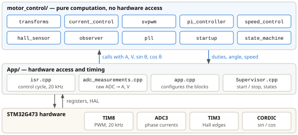
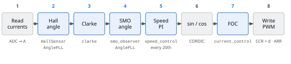

# motor_control

*A small, hardware-independent C++ library for field-oriented control of a PMSM / BLDC motor — with Hall sensors or sensorless. The same sources build for the STM32G4 firmware and for unit tests on the PC.*

## 1. What the library does

- **Current control (FOC):** Clarke and Park transforms, one PI controller per axis, voltage limit, inverse transforms and SVPWM — from measured phase currents to three duty cycles.
- **Speed control:** an outer PI loop that turns a speed error into a torque-current reference.
- **Rotor angle and speed:** from Hall sensors (interpolated between edges, with edge-angle calibration), or without a sensor from a sliding-mode back-EMF observer. A PLL smooths the angle and gives the speed in both cases.
- **Start-up and supervision:** an open-loop angle generator, a motor state machine and fault codes.

The library only does the math. It never touches a register, a HAL function or an interrupt: the application reads the hardware, converts the readings to physical units (A, V, rad), calls the library, and writes the result back to the timer. This is why the same code runs unchanged on the PC, where it is unit-tested.

## 2. Where it sits in the project

<p align="center"></p>

*Figure 1. Three layers. The application (`App/`) owns the hardware and the timing; `motor_control/` is pure computation on plain values and has no hardware dependency.*

## 3. Module map

Each block is a small class or a free function in namespace `motor_control`. Headers are in `inc/`, sources in `src/`.

| Module | Main API | What it does | Details |
|---|---|---|---|
| **Field-oriented control** |  |  |  |
| `transforms` | `clarke, park, inversePark, inverseClarke` | Coordinate transforms abc ↔ αβ ↔ dq | FOC 2, 3, 7 |
| `current_control` | `current_control::update` | Park → d/q PIs with voltage limit → inverse Park → inverse Clarke → SVPWM; returns the duties | FOC 5–7 |
| `svpwm` | `svpwm` | Phase voltages → duty cycles 0…1 (min–max injection) | FOC 8 |
| `pi_controller` | `PiController, PidController` | PI / PID with output limits and anti-windup | FOC 5–6 |
| `speed_control` | `speed_control::update` | Speed PI → $`i_q^*`$, with $`i_d^* = 0`$ | FOC 1 |
| **Rotor angle and speed** |  |  |  |
| `hall_sensor` | `HallSensor` | Hall state → electrical angle and speed; interpolation between edges; edge-angle calibration |  |
| `observer` | `smo_observer::update` | Sliding-mode back-EMF observer (sensorless) | SMO |
| `pll` | `AnglePLL::update, update_emf` | Tracks a measured angle (Hall) or the back-EMF vector (SMO); outputs angle and speed | SMO 8–9 |
| **Start-up and supervision** |  |  |  |
| `startup` | `OpenLoopAngle` | Angle ramp for open-loop start-up |  |
| `state_machine` | `StateMachine` | States IDLE → ADC_OFFSET_CAL → ALIGN → OPEN_LOOP → CLOSED_LOOP, FAULT; fault codes |  |
| **Helpers** |  |  |  |
| `types` | `Iabc_t, I_AlphaBeta_t, Vdq_t, duties_t, SinCos_t …` | Plain data structs passed between the blocks |  |
| `filters` | `LowPassFilter` | First-order low-pass filter |  |
| `math_utils` | `PI, TWO_PI, RAD_TO_RPM …` | Constants |  |
| `motor_parameters` | `MotorParameters, BLF02` | Motor data sheet values (57BLF02) |  |

> “Details” points to the sections of the FOC and SMO documents that explain the block.

## 4. One control cycle

The application calls the blocks from the ADC interrupt, once per PWM period (20 kHz), in this order:

<p align="center"></p>

*Figure 2. One control cycle in the ADC interrupt. Grey: application code (hardware access), blue: library calls. The speed PI runs only every 20th cycle (1 kHz). In the current firmware the FOC uses the Hall angle; the SMO runs alongside it for comparison.*

## 5. Conventions

- **Units:** SI everywhere — A, V, rad, rad/s, s. Angles and speeds are electrical unless the name says otherwise (`_m`, `Rpm`).
- **Transforms:** amplitude-invariant Clarke (factor 2/3); the d axis points along the magnet flux; Park rotates by $`-\theta_e`$.
- **Angle input:** transforms take a `SinCos_t`, not an angle. The caller computes sin and cos once per cycle (CORDIC on the STM32) and the library needs no trigonometry for the transforms.
- **Duty cycles:** 0…1 for centre-aligned PWM; the caller converts them to compare values (CCR = duty · ARR).
- **Timing:** every block is called at a fixed rate; the sample time is part of its configuration (`step_time`, `sample_time`).
- **Numbers:** single-precision `float` only (the Cortex-M4 FPU has no double); no dynamic memory.

## 6. Using the library

A minimal current loop. The configuration is done once; `update` is called every PWM period.

```cpp
#include "current_control.hpp"
using namespace motor_control;

PiConfig_ pi_cfg{ .Kp = KP, .Ki = KI, .step_time = 1.0f / 20000.0f,
                  .out_max = 0.0f, .out_min = 0.0f };     // limits are set from Vdc
current_control foc(pi_cfg, pi_cfg);                      // d-axis and q-axis PI

// ADC interrupt, every PWM period:
Iabc_t    iabc = read_phase_currents();                   // application: ADC → A
SinCos_t  sc   = sin_cos(theta_e);                        // angle from Hall or SMO + PLL
Idq_ref_t ref  = { .id_ref = 0.0f, .iq_ref = iq_ref };    // i_d* = 0
duties_t  d    = foc.update(ref, iabc, sc, vdc);          // Clarke … SVPWM
write_pwm(d);                                             // application: CCR = duty · ARR
```

The full wiring of all blocks — Hall sensor, SMO, PLLs, speed loop and state machine — is in `App/Src/app.cpp` (configuration) and `App/Src/isr.cpp` (control cycle).

## 7. Building and testing

`motor_control/CMakeLists.txt` builds a static library from every `src/*.cpp`; a new source file is picked up automatically. It is compiled with `-Wall -Wextra -Wpedantic` and with `-Wdouble-promotion -Wfloat-conversion`, which catch any accidental use of `double`.

The unit tests in `tests/` use GoogleTest and run on the PC: `test_transforms`, `test_svpwm`, `test_pi_controller`, `test_current_control` and `test_pll`. GoogleTest is downloaded automatically on the first configure, and the tests are registered with CTest.

## 8. Further reading

- [**Field-Oriented Control (FOC)**](docs/foc.md) — what FOC is, Clarke and Park, the dq model, current PIs and pole–zero cancellation, voltage limit, SVPWM.
- [**Sliding-Mode Back-EMF Observer**](docs/smo.md) — the sensorless angle: observer, Lyapunov proof, back-EMF, PLL and its gains, discretization.
