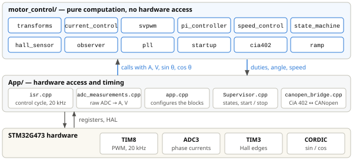
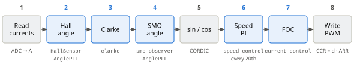

# motor_control

*A small, hardware-independent C++ library for field-oriented control of a PMSM / BLDC motor — with Hall sensors or sensorless. The same sources build for the STM32G4 firmware and for unit tests on the PC.*

## 1. What the library does

- **Current control (FOC):** Clarke and Park transforms, one PI controller per axis, voltage limit, inverse transforms and SVPWM — from measured phase currents to three duty cycles.
- **Speed control:** an outer PI loop that turns a speed error into a torque-current reference.
- **Rotor angle and speed:** from Hall sensors (interpolated between edges, with edge-angle calibration), or without a sensor from a sliding-mode back-EMF observer. A PLL smooths the angle and gives the speed in both cases.
- **Start-up and supervision:** an open-loop angle generator, a motor state machine and fault codes.
- **CiA 402 drive logic:** the CiA 402 state machine, controlword decoding, statusword and error codes, and the speed and torque ramps. The CANopen stack itself stays in the application.
- **Gate driver:** DRV8350S settings and fault status over SPI. The library builds and checks the SPI frames; the application passes the function that sends one frame.

The library only does the math. It never touches a register, a HAL function, an RTOS call or an interrupt. The application reads the hardware, converts the readings to physical units (A, V, rad), calls the library, and writes the result back to the timer. This is why the same code runs unchanged on the PC, where it is unit-tested.

## 2. Where it sits in the project

<p align="center"></p>

*Figure 1. Three layers. The application (`App/`) owns the hardware and the timing; `motor_control/` is pure computation on plain values and has no hardware dependency.*

## 3. Module map

Each block is a small class or a free function in namespace `motor_control`. Headers are in [`inc/`](inc/), sources in [`src/`](src/).

| Module | Main API | What it does | Details |
|---|---|---|---|
| **Field-oriented control** |  |  |  |
| `transforms` | `clarke, park, inversePark, inverseClarke` | Coordinate transforms abc ↔ αβ ↔ dq | FOC 2, 3, 7 |
| `current_control` | `current_control::update` | Clarke → Park → d/q PIs with voltage limit → inverse Park → inverse Clarke → SVPWM; returns the duties | FOC 5–7 |
| `svpwm` | `svpwm` | Phase voltages → duty cycles 0…1 (min–max injection) | FOC 8 |
| `pi_controller` | `PiController, PidController` | PI / PID with output limits and anti-windup | FOC 5–6 |
| `speed_control` | `speed_control::update` | Speed PI → $`i_q^*`$, with $`i_d^* = 0`$ (a `PidController`; the firmware sets $`K_d = 0`$) | FOC 1 |
| **Rotor angle and speed** |  |  |  |
| `hall_sensor` | `HallSensor` | Hall state → electrical angle and speed; interpolation between edges; edge-angle calibration |  |
| `observer` | `smo_observer::update` | Sliding-mode back-EMF observer (sensorless) | SMO |
| `pll` | `AnglePLL::update, update_emf` | Tracks a measured angle (Hall) or the back-EMF vector (SMO); outputs angle and speed | SMO 8–9 |
| **Start-up and supervision** |  |  |  |
| `startup` | `OpenLoopAngle` | Angle ramp for open-loop start-up and Hall calibration |  |
| `state_machine` | `StateMachine` | States INIT, IDLE, ALIGN, OPEN_LOOP, CLOSED_LOOP, CALIBRATING, FAULT; events; fault codes | Section 4 |
| `foc_mode` | `AngleSource, LoopMode, SensorMode` | Where the control cycle gets its angle (fixed, open loop, Hall, SMO) and which loop it closes (off, current, speed) | Section 4 |
| **CiA 402 drive profile** |  |  |  |
| `cia402` | `Cia402, decode_controlword, cia402_error_code` | CiA 402 state machine on top of the motor states; controlword → command, statusword, fault code → EMCY error code | CANopen 10 |
| `ramp` | `Ramp` | Reference that moves to its target at a fixed slope (profile velocity and torque ramps) | CANopen 10.3 |
| **Gate driver** |  |  |  |
| `drv8350s` | `Drv8350s::configure, read_status` | Writes the DRV8350S settings (dead time, over-current, gate current) and reads them back; reads the fault status registers | TI SLVSDY6A |
| **Helpers** |  |  |  |
| `types` | `Iabc_t, I_AlphaBeta_t, Vdq_t, duties_t, SinCos_t …` | Plain data structs passed between the blocks |  |
| `filters` | `LowPassFilter` | First-order low-pass filter |  |
| `ntc` | `ntc_temp_c` | NTC thermistor ADC reading → temperature (Beta formula) |  |
| `math_utils` | `PI, TWO_PI, RAD_TO_RPM, wrap_2pi, wrap_pi, sincos_std` | Constants, angle wrapping, sin and cos with the C library |  |
| `motor_parameters` | `MotorParameters, BLF02` | Motor data sheet values (57BLF02) |  |

> “Details” points to the sections of the FOC, SMO and CANopen documents that explain the block, or to a section of this page.

## 4. One control cycle

The application calls the blocks from the ADC interrupt, once per PWM period (20 kHz), in this order:

<p align="center"></p>

*Figure 2. One control cycle in the ADC interrupt (`App/Src/isr.cpp`). Grey: application code (hardware access), blue: library calls. The Hall and the SMO angles are both updated in every cycle; the FOC uses one of them. The speed PI runs only every 20th cycle (1 kHz), and only in speed mode.*

The motor state decides which angle the FOC uses and which loop it closes. The Supervisor task sets this on every state change (`set_foc_mode` in [`App/Src/app.cpp`](../App/Src/app.cpp)):

| Motor state | Angle for Park and inverse Park | Current reference |
|---|---|---|
| `INIT, IDLE, FAULT` | — (PWM off, the FOC does not run) | — |
| `ALIGN` | Fixed angle: first 90°, then 0° | $`i_d^* = 1`$ A, $`i_q^* = 0`$ |
| `OPEN_LOOP` | Open-loop angle ramp up to 500 rpm | $`i_q^* = 2`$ A, then lowered step by step |
| `CALIBRATING` | Fixed angle (align), then an open-loop angle ramp, one mechanical turn each way | $`i_d^* = 1`$ A, $`i_q^* = 0`$ |
| `CLOSED_LOOP` | Hall + PLL, or SMO + PLL (chosen at start) | Speed PI in speed mode; in current (torque) mode $`i_q^*`$ comes from the command |

A Hall start goes from `IDLE` straight to `CLOSED_LOOP`. A sensorless start goes `IDLE` → `ALIGN` → `OPEN_LOOP` → `CLOSED_LOOP`, because the observer sees no back-EMF at standstill. Over CANopen, profile torque mode always uses the Hall angle.

## 5. Conventions

- **Units:** SI — A, V, rad, rad/s, s. Angles and speeds are electrical unless the name says otherwise (`Mechanical`, `Rpm`). One exception: the speed loop works in mechanical rpm, so its gains are in A/rpm.
- **Transforms:** amplitude-invariant Clarke (factor 2/3); the d axis points along the magnet flux; Park rotates by $`-\theta_e`$.
- **Angle input:** transforms take a `SinCos_t`, not an angle. The caller computes sin and cos once per cycle (CORDIC on the STM32) and the library needs no trigonometry for the transforms.
- **Duty cycles:** 0…1 for centre-aligned PWM; the caller converts them to compare values (CCR = duty · ARR).
- **Timing:** every block is called at a fixed rate; the sample time is part of its configuration (`step_time`, `sample_time`).
- **Numbers:** single-precision `float` only (the Cortex-M4 FPU is single precision); no dynamic memory.

## 6. Using the library

A minimal current loop. The configuration is done once; `update` is called every PWM period.

```cpp
#include "current_control.hpp"
#include "math_utils.hpp"
using namespace motor_control;

PiConfig_ pi_cfg{ .Kp = KP, .Ki = KI, .step_time = 1.0f / 20000.0f,
                  .out_max = 0.0f, .out_min = 0.0f };     // limits are set from Vdc
current_control foc(pi_cfg, pi_cfg);                      // d-axis and q-axis PI

// ADC interrupt, every PWM period:
Iabc_t    iabc = read_phase_currents();                   // application: ADC → A
SinCos_t  sc   = sincos_std(theta_e);                     // angle from Hall or SMO + PLL (CORDIC on the STM32)
Idq_ref_t ref  = { .id_ref = 0.0f, .iq_ref = iq_ref };    // i_d* = 0
duties_t  d    = foc.update(ref, iabc, sc, vdc);          // Clarke … SVPWM
write_pwm(d);                                             // application: CCR = duty · ARR
```

The application wires all blocks together:

- [`App/Src/app.cpp`](../App/Src/app.cpp) configures them.
- [`App/Src/isr.cpp`](../App/Src/isr.cpp) runs the control cycle.
- [`App/Src/Supervisor.cpp`](../App/Src/Supervisor.cpp) and [`App/Src/StartupSeq.cpp`](../App/Src/StartupSeq.cpp) run the state machine and the start-up steps.
- [`App/Src/canopen_bridge.cpp`](../App/Src/canopen_bridge.cpp) connects the CiA 402 logic to the CANopen object dictionary.

## 7. Building and testing

[`motor_control/CMakeLists.txt`](CMakeLists.txt) builds a static library from every `src/*.cpp`; a new source file is picked up automatically. It is compiled with `-Wall -Wextra -Wpedantic` and with `-Wdouble-promotion -Wfloat-conversion`, which catch any accidental use of `double`.

The unit tests are in [`tests/`](../tests/) at the repository root. They use GoogleTest and run on the PC; the files `test_*.cpp` (for example `test_transforms`, `test_smo_pll`, `test_cia402`) are built into one test program. GoogleTest is downloaded when CMake first configures the project, and the tests are registered with CTest. Run them from the repository root with `cmake --preset HostTests`, `cmake --build --preset HostTests` and `ctest --preset HostTests` (needs a host `g++`).

## 8. Further reading

- [**Field-Oriented Control (FOC)**](docs/foc.md) — what FOC is, Clarke and Park, the dq model, current PIs and pole–zero cancellation, voltage limit, SVPWM.
- [**Sliding-Mode Back-EMF Observer**](docs/smo.md) — the sensorless angle: observer, Lyapunov proof, back-EMF, PLL and its gains, discretization.
- [**CANopen Guide**](../docs/canopen.md) — CAN, CANopen and the CiA 402 drive profile, with example frames.
