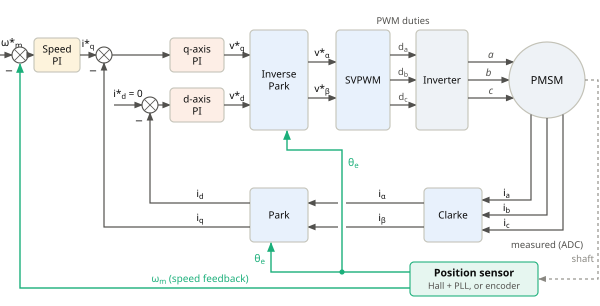
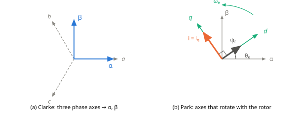
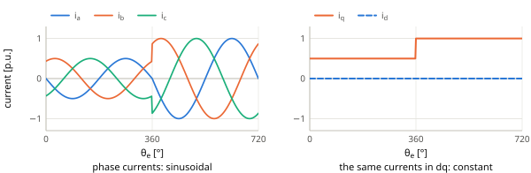
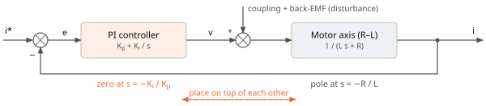
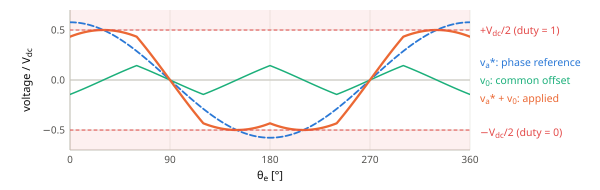

# Field-Oriented Control (FOC)

*What FOC is and how each block works — from the block diagram down to the code in `transforms.cpp`, `current_control.cpp` and `svpwm.cpp`.*

## 1. What is field-oriented control?

A PMSM produces torque when the magnetic field of the stator currents pulls on the rotor magnets. How much torque a given current produces depends on the **angle** between the two fields: it is largest when the stator field is 90° (electrical) ahead of the magnet field, and zero when the two are aligned. As the rotor turns, the controller has to turn the stator field with it.

**Field-oriented control** does this by describing the stator currents in a coordinate frame that is *oriented on the magnet field* and rotates with the rotor. In this frame the three AC phase currents become two DC quantities: $`i_d`$, which points along the magnet field and produces no torque, and $`i_q`$, which is 90° ahead and produces all of it. Controlling a three-phase AC motor then becomes as simple as controlling two DC currents with two PI controllers — just like a DC motor, whose torque is proportional to its current.

<p align="center"></p>

*Figure 1. Field-oriented control with a position sensor. The inner current loop runs every PWM period (20 kHz), the outer speed loop at 1 kHz. The q reference comes from the speed PI, the d reference is zero. The position sensor on the shaft gives the electrical rotor angle $`\theta_e`$ for Park and inverse Park, and the speed $`\omega_m`$ for the speed loop.*

Following the signals around the diagram, one control cycle does this:

1. **Speed PI** compares the speed reference $`\omega_m^*`$ with the measured speed $`\omega_m`$ and asks for a torque current $`i_q^*`$. The other reference is $`i_d^* = 0`$ (Section 3).
2. Two current PIs, one per axis: the **q-axis PI** compares $`i_q^*`$ with the measured $`i_q`$ and computes $`v_q^*`$; the **d-axis PI** compares $`i_d^* = 0`$ with $`i_d`$ and computes $`v_d^*`$ (Sections 4–6).
3. **Inverse Park** limits $`v_d^*`$, $`v_q^*`$ to what the inverter can deliver and turns them from the rotating frame back into the stationary αβ frame (Section 7).
4. **SVPWM** converts $`v_\alpha^*`$, $`v_\beta^*`$ into three duty cycles $`d_a`$, $`d_b`$, $`d_c`$, and the **inverter** applies them to the motor windings (Section 8).
5. The ADC measures the phase currents $`i_a`$, $`i_b`$, $`i_c`$. **Clarke** reduces them to two currents $`i_\alpha`$, $`i_\beta`$ (Section 2) and **Park** rotates these into $`i_d`$, $`i_q`$ (Section 3), using the angle $`\theta_e`$ from the **position sensor**. These are the feedback values of step 2.

The speed loop runs 20 times slower than the current loop. This is the cascade rule: the outer loop must be clearly slower (at least 5–10×) than the inner one, so that it sees an ideal current loop ($`i_q = i_q^*`$). The following sections explain the blocks one by one: first the transforms (Sections 2–3) and the motor model they lead to (Section 4), then the current controllers (Sections 5–7) and finally the modulation (Section 8).

## 2. From three phases to two: the Clarke transform

The motor is star-connected with a floating neutral, so the three phase currents always add up to zero: $`i_a + i_b + i_c = 0`$. Only two of them are independent. The Clarke transform projects the three phase axes (120° apart) onto two perpendicular axes, α (along phase a) and β (Figure 2a):

```math
i_\alpha = \frac{2i_a - i_b - i_c}{3},\qquad i_\beta = \frac{i_b - i_c}{\sqrt{3}} \tag{1}
```

The same transform in matrix form:

```math
\begin{bmatrix} i_\alpha \\ i_\beta \end{bmatrix} = \frac{2}{3}\begin{bmatrix} 1 & -\frac12 & -\frac12 \\ 0 & \frac{\sqrt3}{2} & -\frac{\sqrt3}{2} \end{bmatrix}\begin{bmatrix} i_a \\ i_b \\ i_c \end{bmatrix} \tag{2}
```

The factor $`\tfrac23`$ makes the transform **amplitude-invariant**: three sinusoidal currents of amplitude $`I`$ become one vector of length $`I`$ that rotates in the αβ plane, $`i_\alpha = I\cos\phi`$, $`i_\beta = I\sin\phi`$. Voltages are transformed in the same way.

<p align="center"></p>

*Figure 2. (a) The Clarke transform replaces the three phase axes a, b, c by two perpendicular axes α, β. (b) The Park transform looks at the same vector from axes d, q that rotate with the rotor; d points along the magnet flux $`\psi_f`$. In FOC the current is placed on the q axis.*

## 3. Into the rotor frame: the Park transform

In the αβ frame the current vector rotates with the rotor at $`\omega_e`$, so its references would be sinusoids — hard to control with a PI. Instead we look at it from axes that rotate with the rotor: d along the magnet flux (at the electrical rotor angle $`\theta_e`$) and q 90° ahead (Figure 2b):

```math
i_d = i_\alpha\cos\theta_e + i_\beta\sin\theta_e,\qquad i_q = -i_\alpha\sin\theta_e + i_\beta\cos\theta_e \tag{3}
```

In matrix form it is a rotation by $`-\theta_e`$:

```math
\begin{bmatrix} i_d \\ i_q \end{bmatrix} = \begin{bmatrix} \cos\theta_e & \sin\theta_e \\ -\sin\theta_e & \cos\theta_e \end{bmatrix}\begin{bmatrix} i_\alpha \\ i_\beta \end{bmatrix} \tag{4}
```

$`i_d`$ is the part of the current along the flux, $`i_q`$ the part at 90° to it. In steady state they are **constants** (Figure 3), which a PI controller can track without error.

**Why $`i_d = 0`$?** A current vector of length $`I`$ at an angle $`\gamma`$ from the magnet flux produces the torque

```math
T_e = \tfrac{3}{2}\,p\,\psi_f\,I\sin\gamma \tag{5}
```

> $`T_e`$: electromagnetic torque [N·m] · $`p`$: pole pairs · $`\psi_f`$: magnet flux linkage [Wb] · $`I`$: current amplitude [A] · $`\gamma`$: angle between the magnet flux and the current vector.

The same current gives the most torque at $`\gamma = 90°`$, that is when the whole current lies on the q axis: $`i_d = 0`$ and $`I\sin\gamma = i_q`$. Equation (5) becomes

```math
T_e = \tfrac{3}{2}\,p\,\psi_f\,i_q \tag{6}
```

The torque is proportional to one current, as in a DC motor. FOC therefore uses the references $`i_d^* = 0`$ and $`i_q^* \propto T^*`$ (a star marks a reference).

<p align="center"></p>

*Figure 3. The same currents in two frames. Left: phase currents; at 360° the amplitude is doubled. Right: in the dq frame $`i_q`$ simply steps from 0.5 to 1 and $`i_d`$ stays 0.*

## 4. The motor in the dq frame

For a surface-mounted PMSM ($`L_d = L_q = L`$) the voltage equations in the dq frame are:

```math
v_d = R\,i_d + L\frac{di_d}{dt} - \omega_e L\,i_q,\qquad v_q = R\,i_q + L\frac{di_q}{dt} + \omega_e L\,i_d + \omega_e\psi_f \tag{7}
```

> $`v_d, v_q`$: dq voltages [V] · $`R`$: phase resistance [Ω] · $`L`$: phase inductance [H] · $`\omega_e = p\,\omega_m`$: electrical speed [rad/s] · $`\omega_e\psi_f`$: back-EMF, which appears only on the q axis.

Each axis is an R–L circuit (first two terms) plus terms that come from the rotation of the frame: the cross-coupling $`\omega_e L\,i_q`$, $`\omega_e L\,i_d`$ and the back-EMF $`\omega_e\psi_f`$. They change slowly compared with the current, so the current controller treats them as **disturbances** that its integral part removes. The rotor follows the mechanical equation $`J\,d\omega_m/dt = T_e - T_L - B\,\omega_m`$ ($`J`$: inertia, $`T_L`$: load torque, $`B`$: friction).

## 5. The current controllers

Without the disturbances each axis is $`L\,di/dt = -R\,i + v`$. In the Laplace domain the motor axis (the “plant”) is

```math
P(s) = \frac{I(s)}{V(s)} = \frac{1}{L\,s + R} = \frac{1/R}{\tau\,s + 1},\qquad \tau = \frac{L}{R} \tag{8}
```

> $`s`$: Laplace variable · $`\tau`$: electrical time constant [s]. The plant has one pole at $`s = -R/L`$.

Each axis gets a PI controller, $`d`$ and $`q`$ separately:

```math
C(s) = K_p + \frac{K_i}{s} = K_p\,\frac{s + K_i/K_p}{s} \tag{9}
```

The integrator (pole at $`s = 0`$) removes any steady error and the slow disturbances of (7). The PI also has a zero at $`s = -K_i/K_p`$, and where we put this zero is the key to choosing the gains.

<p align="center"></p>

*Figure 4. One current axis. The PI zero is placed exactly on the slow pole of the motor axis, so the two cancel.*

## 6. Choosing the gains: pole–zero cancellation

The plant pole $`s = -R/L`$ is slow (it is the electrical time constant). We place the PI zero exactly on it and look at what remains:

```math
\begin{array}{ll}
\displaystyle \frac{K_i}{K_p} = \frac{R}{L} & \qquad \text{zero on the plant pole} \\[4pt]
\displaystyle C(s)\,P(s) = K_p\,\frac{s + R/L}{s}\cdot\frac{1}{L\,(s + R/L)} & \qquad \text{open loop} \\[4pt]
\displaystyle = \frac{K_p}{L\,s} & \qquad \text{pole and zero cancel: a pure integrator} \\[4pt]
\displaystyle \frac{I(s)}{I^*(s)} = \frac{C P}{1 + C P} = \frac{K_p/L}{s + K_p/L} & \qquad \text{closed loop}
\end{array}
```

The closed loop is a first-order low-pass filter. We name its bandwidth $`\omega_c = K_p/L`$ and obtain the rule:

```math
K_p = L\,\omega_c,\qquad K_i = R\,\omega_c \tag{10}
```

> $`\omega_c`$: current-loop bandwidth [rad/s] — the only value to choose; both gains follow from the motor’s $`R`$ and $`L`$.

The current follows its reference without overshoot, with time constant $`1/\omega_c`$ (63 % after $`1/\omega_c`$, 95 % after $`3/\omega_c`$). The upper limit for $`\omega_c`$ is set by the digital loop: measuring, computing and applying the voltage take about $`1.5\,T_s`$, so $`\omega_c`$ must stay well below the sampling frequency; a common rule is $`\omega_c \le 2\pi f_s/20`$ ($`f_s = 1/T_s`$). If $`R`$ and $`L`$ are not exact, the cancellation is not exact either: a wrong $`L`$ changes the bandwidth, a wrong $`R`$ leaves a slow tail in the step response.

## 7. Voltage limit and back to the stator

The PI outputs are the voltage references $`v_d^*`$, $`v_q^*`$. The inverter can only produce voltage vectors inside a circle of radius $`V_{max} = V_{dc}/\sqrt{3}`$ (Section 8). The code gives the d axis priority, so that the flux-related $`v_d^*`$ is never cut first:

```math
|v_d^*| \le V_{max},\qquad |v_q^*| \le \sqrt{V_{max}^2 - (v_d^*)^2},\qquad V_{max} = \frac{V_{dc}}{\sqrt{3}} \tag{11}
```

While an output is at its limit, its integral is frozen (anti-windup), so the controller does not “wind up” and overshoot later. The voltages are then turned back into the stator frame with the inverse Park and inverse Clarke transforms:

```math
v_\alpha^* = v_d^*\cos\theta_e - v_q^*\sin\theta_e,\qquad v_\beta^* = v_d^*\sin\theta_e + v_q^*\cos\theta_e \tag{12}
```

```math
v_a^* = v_\alpha^*,\qquad v_b^* = -\tfrac12 v_\alpha^* + \tfrac{\sqrt3}{2} v_\beta^*,\qquad v_c^* = -\tfrac12 v_\alpha^* - \tfrac{\sqrt3}{2} v_\beta^* \tag{13}
```

## 8. SVPWM: from voltages to duty cycles

Each inverter leg connects its phase either to $`+V_{dc}`$ or to 0. Averaged over one PWM period, the leg voltage is $`d\cdot V_{dc}`$, where $`d`$ is the duty cycle (0…1). Plain sinusoidal PWM uses $`d_x = \tfrac12 + v_x^*/V_{dc}`$, which only reaches a phase amplitude of $`V_{dc}/2`$. But the motor neutral is floating: adding the same voltage $`v_0`$ to all three phases does not change the line-to-line voltages, and therefore not the currents. SVPWM uses this freedom to centre the three references in the available range:

```math
v_0 = -\frac{\max(v_a^*, v_b^*, v_c^*) + \min(v_a^*, v_b^*, v_c^*)}{2},\qquad d_x = \frac12 + \frac{v_x^* + v_0}{V_{dc}},\quad x \in \{a, b, c\} \tag{14}
```

This “min–max injection” gives the same switching times as classical space-vector modulation and raises the largest phase amplitude from $`V_{dc}/2`$ to $`V_{dc}/\sqrt{3}`$ (+15.5 %) — the $`V_{max}`$ of (11). The duties are written to the timer compare registers ($`\text{CCR} = d\cdot\text{ARR}`$).

<p align="center"></p>

*Figure 5. SVPWM at the largest amplitude $`V_{dc}/\sqrt3`$. The phase reference alone (blue) would exceed $`\pm V_{dc}/2`$; after adding the common offset $`v_0`$ (green) the result (orange) fits, and the line-to-line voltages are unchanged.*
