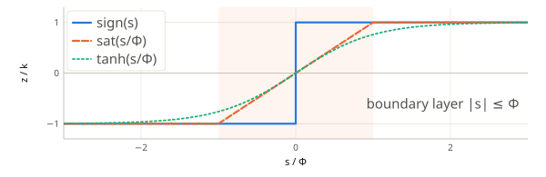
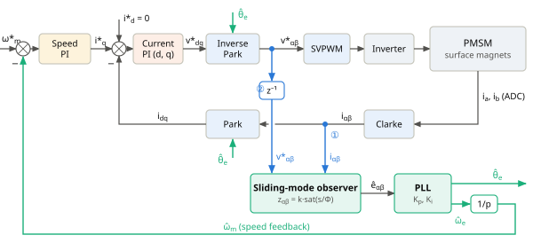

# Sliding-Mode Back-EMF Observer

*How the rotor angle and speed are estimated without a position sensor — step by step, from the motor model to the code in `observer.cpp` and `pll.cpp`.*

## 1. The αβ model of a surface-mounted motor

After the Clarke transform, each axis of a surface-mounted PMSM is a resistor, an inductor and a voltage source in series:

```math
L\frac{di_\alpha}{dt} = -R\,i_\alpha + v_\alpha - e_\alpha,\qquad L\frac{di_\beta}{dt} = -R\,i_\beta + v_\beta - e_\beta \tag{1}
```

> $`i_\alpha, i_\beta`$: stator currents [A] (measured) · $`v_\alpha, v_\beta`$: stator voltages [V] · $`R`$: phase resistance [Ω] · $`L`$: phase inductance [H] (surface magnets ⇒ $`L_d = L_q = L`$, one value for both axes) · $`e_\alpha, e_\beta`$: back-EMF [V] (unknown).

The back-EMF is the voltage induced by the rotating magnet. Its direction carries the angle, its length carries the speed:

```math
e_\alpha = -E\sin\theta_e,\qquad e_\beta = E\cos\theta_e,\qquad E = \omega_e\,\psi_f = p\,\omega_m\,\psi_f \tag{2}
```

> $`\theta_e`$: electrical rotor angle · $`\omega_e`$, $`\omega_m`$: electrical and mechanical speed [rad/s] · $`p`$: pole pairs · $`\psi_f`$: magnet flux linkage [Wb] · $`E`$: back-EMF amplitude [V].

Each component is never larger than the amplitude, and the amplitude is largest at the highest speed:

```math
|e_\alpha|,\ |e_\beta| \le E \le E_{max} = p\,\omega_{m,max}\,\psi_f \tag{3}
```

This bound is the only thing the observer needs to know about the back-EMF.

## 2. The observer model

We run a copy of (1) in software. The back-EMF is unknown, so we replace it with a **correction term** $`z`$. A hat ($`\hat{\ }`$) marks an estimate:

```math
L\frac{d\hat{i}_\alpha}{dt} = -R\,\hat{i}_\alpha + v_\alpha - z_\alpha,\qquad L\frac{d\hat{i}_\beta}{dt} = -R\,\hat{i}_\beta + v_\beta - z_\beta \tag{4}
```

**Why the correction term?** With $`z = 0`$ the model runs open-loop: it does not know $`e`$, so $`\hat{i}`$ drifts away from the measured $`i`$. The correction compares the model with the measurement and pushes $`\hat{i}`$ back to $`i`$. Since the only difference between (1) and (4) is $`e`$ versus $`z`$, the correction that keeps $`\hat{i} = i`$ *must be equal to* $`e`$. We get the back-EMF from the correction.

In a sliding-mode observer the correction is a switching function with gain $`k`$ [V]:

```math
z_\alpha = k\operatorname{sign}(s_\alpha),\qquad z_\beta = k\operatorname{sign}(s_\beta),\qquad \operatorname{sign}(s) = \begin{cases} +1, & s \gt 0 \\ -1, & s \lt 0 \end{cases} \tag{5}
```

## 3. The current error

```math
s_\alpha = \hat{i}_\alpha - i_\alpha,\qquad s_\beta = \hat{i}_\beta - i_\beta \tag{6}
```

If $`s \gt 0`$ the model current is too high; then $`z = +k`$ and the term $`-z`$ in (4) pulls $`\hat{i}`$ down. If $`s \lt 0`$ the opposite happens. Subtracting (1) from (4) gives the error dynamics (α axis; β is identical, so we drop the index from now on):

```math
L\frac{ds}{dt} = -R\,s + e - k\operatorname{sign}(s) \tag{7}
```

Two inputs act on the error: the unknown $`e`$ pushes $`s`$ away from zero, the correction pushes it back.

## 4. Lyapunov function

To show that $`s \to 0`$ without solving (7), we use the “energy” of the error (the magnetic energy that the error current would store in $`L`$):

```math
V = \tfrac{1}{2}\,L\,s^2 \tag{8}
```

$`V \ge 0`$, and $`V = 0`$ only when $`s = 0`$. If $`V`$ decreases whenever $`s \ne 0`$, the error must go to zero.

## 5. The derivative of V is always negative

```math
\begin{array}{ll}
\displaystyle \frac{dV}{dt} = s\,L\frac{ds}{dt} & \qquad \text{chain rule} \\[4pt]
\displaystyle = s\left(-R\,s + e - k\operatorname{sign}(s)\right) & \qquad \text{insert (7)} \\[4pt]
\displaystyle = -R\,s^2 + s\,e - k\,|s| & \qquad s\operatorname{sign}(s) = |s| \\[4pt]
\displaystyle \le -R\,s^2 + |s|\,E_{max} - k\,|s| & \qquad s\,e \le |s|\,|e| \le |s|\,E_{max}\text{, from (3)} \\[4pt]
\displaystyle = -R\,s^2 - \left(k - E_{max}\right)|s| & \qquad 
\end{array}
```

## 6. Choosing k > $``E_{max}``$ drives the error to zero

```math
k \gt E_{max} \tag{9}
```

With this choice both terms of the last line are negative for every $`s \ne 0`$. Then $`dV/dt \lt 0`$, so $`V`$ — and with it $`|s|`$ — keeps decreasing until $`s = 0`$. It even gets there in finite time. Dividing the last line by $`L|s|`$:

```math
\frac{d|s|}{dt} \le -\frac{k - E_{max}}{L}\qquad\Rightarrow\qquad t_r \le \frac{L\,|s(0)|}{k - E_{max}} \tag{10}
```

> $`t_r`$: reaching time, after which $`s = 0`$. In practice $`k \approx 1.2\ldots1.5\,E_{max}`$ at the highest speed; a larger $`k`$ only adds switching noise.

## 7. The equivalent injection equals the back-EMF

Once $`s = 0`$ is reached, the error stays there: $`s = 0`$ and $`ds/dt = 0`$. Inserting this into (7):

```math
0 = -R\cdot 0 + e - z_{eq}\qquad\Rightarrow\qquad z_{eq} = e \tag{11}
```

$`z`$ itself jumps between $`+k`$ and $`-k`$. Its average (low-frequency part) is called the **equivalent injection** $`z_{eq}`$, and it equals the back-EMF. So the estimated back-EMF is simply the correction: $`\hat{e}_\alpha = z_\alpha`$, $`\hat{e}_\beta = z_\beta`$. The switching part is removed by the PLL in the next step, which also acts as a low-pass filter.

## 8. Extracting angle and speed with a PLL

From (2), $`\theta_e = \operatorname{atan2}(-\hat{e}_\alpha, \hat{e}_\beta)`$ would work, but it follows every noise spike and gives no speed. A phase-locked loop (PLL) keeps its own estimates $`\hat{\theta}_e`$, $`\hat{\omega}_e`$ and corrects them. The **phase detector** measures how far $`\hat{\theta}_e`$ is from the true angle:

```math
\varepsilon = \frac{-\hat{e}_\alpha\cos\hat{\theta}_e - \hat{e}_\beta\sin\hat{\theta}_e}{\hat{E}},\qquad \hat{E} = \sqrt{\hat{e}_\alpha^2 + \hat{e}_\beta^2} \tag{12}
```

Inserting (2) into the numerator: $`E\sin\theta_e\cos\hat{\theta}_e - E\cos\theta_e\sin\hat{\theta}_e = E\sin(\theta_e - \hat{\theta}_e)`$. Dividing by $`\hat{E} \approx E`$:

```math
\varepsilon = \sin(\theta_e - \hat{\theta}_e) \approx \theta_e - \hat{\theta}_e\qquad\text{(small error)} \tag{13}
```

The division makes $`\varepsilon`$ independent of the speed ($`E \propto \omega_e`$), so the PLL behaves the same at all speeds. A PI controller turns the angle error into a speed, and an integrator turns the speed into an angle:

```math
\hat{\omega}_e = K_p\,\varepsilon + K_i\!\int\!\varepsilon\,dt,\qquad \hat{\theta}_e = \int\hat{\omega}_e\,dt,\qquad \hat{\omega}_m = \frac{\hat{\omega}_e}{p} \tag{14}
```

If $`\hat{\theta}_e`$ lags, $`\varepsilon \gt 0`$, $`\hat{\omega}_e`$ increases and $`\hat{\theta}_e`$ catches up. In steady state $`\varepsilon = 0`$: $`\hat{\theta}_e = \theta_e`$, and the integral term holds $`\hat{\omega}_e = \omega_e`$.

## 9. Choosing the PLL gains

With $`\varepsilon \approx \theta_e - \hat{\theta}_e`$ the loop is linear. In the Laplace domain (here $`s`$ is the Laplace variable, not the current error):

```math
\hat{\theta}_e = \frac{1}{s}\left(K_p + \frac{K_i}{s}\right)(\theta_e - \hat{\theta}_e)\quad\Rightarrow\quad \frac{\hat{\theta}_e}{\theta_e} = \frac{K_p\,s + K_i}{s^2 + K_p\,s + K_i} \tag{15}
```

Matching the denominator with the standard second-order form $`s^2 + 2\zeta\omega_n s + \omega_n^2`$ gives the gains:

```math
K_p = 2\zeta\omega_n,\qquad K_i = \omega_n^2 \tag{16}
```

> $`\omega_n`$: PLL bandwidth [rad/s] · $`\zeta`$: damping (0.7…1). A higher $`\omega_n`$ tracks speed changes faster (the angle lag under an electrical acceleration $`\alpha_e`$ is $`\alpha_e/\omega_n^2`$); a lower $`\omega_n`$ filters more noise. This project: $`f_n = 30`$ Hz, $`\zeta = 0.8`$ ⇒ $`\omega_n = 188.5`$ rad/s, $`K_p = 301.6`$ rad/s, $`K_i = 3.55\cdot 10^4`$ rad/s².

## 10. Why we replace sign(s) with a smooth function

The proof above assumes that sign() switches infinitely fast. A controller updates $`z`$ only once per sample $`T_s`$, so $`s`$ never sits exactly at zero: $`z`$ flips between $`+k`$ and $`-k`$ every few samples. This **chattering** makes $`\hat{e}`$ a square wave of amplitude $`k`$ around the true $`e`$. Filtering it needs a low cut-off, which adds phase lag and therefore angle error; it also amplifies current-measurement noise. The fix is a function that acts like sign() far from zero and is linear near zero, e.g. the saturation function with **boundary layer** $`\Phi`$ [A]:

```math
z = k\operatorname{sat}\!\left(\frac{s}{\Phi}\right),\qquad \operatorname{sat}(x) = \begin{cases} x, & |x| \le 1 \\ \operatorname{sign}(x), & |x| \gt 1 \end{cases} \tag{17}
```

<p align="center"></p>

*Figure 1. Switching functions. Outside the boundary layer ($`|s| \gt \Phi`$) all of them give $`z = \pm k`$; inside, the smooth ones are linear and do not switch.*

Outside the layer $`z = \pm k`$ exactly as before, so steps 4–6 still hold and $`s`$ is driven into $`|s| \le \Phi`$. Inside, $`z = (k/\Phi)\,s`$ is a smooth, linear correction, and $`z`$ settles at $`e`$ with a small current offset $`s = \Phi e/k`$ (harmless, because we use $`z`$, not $`s`$). Other choices are $`\tanh(s/\Phi)`$ or $`s/(|s| + \delta)`$. A larger $`\Phi`$ gives a smoother $`\hat{e}`$ but a slower correction; a smaller $`\Phi`$ approaches sign() and its chattering.

## 11. The observer inside the FOC loop

<p align="center"></p>

*Figure 2. Sensorless FOC with the sliding-mode observer. The observer needs two signals the FOC already computes: ① $`i_{\alpha\beta}`$, the Clarke transform of the measured phase currents, and ② $`v^*_{\alpha\beta}`$, the inverse-Park output sent to SVPWM, taken from the previous PWM period ($`z^{-1}`$: the voltage the inverter applied while the measured current was changing). Its outputs $`\hat{\theta}_e`$ (Park and inverse Park) and $`\hat{\omega}_m`$ (speed loop) replace the position sensor.*

## 12. Final equations and discretization

The observer runs once per PWM period $`T_s`$. We replace the derivative in (4) with a forward difference (forward Euler):

```math
\begin{array}{ll}
\displaystyle \frac{d\hat{i}}{dt} \approx \frac{\hat{i}[n+1] - \hat{i}[n]}{T_s} & \qquad \text{forward Euler, }n\text{: sample index} \\[4pt]
\displaystyle L\,\frac{\hat{i}[n+1] - \hat{i}[n]}{T_s} = -R\,\hat{i}[n] + v[n] - z[n] & \qquad \text{insert into (4)} \\[4pt]
\displaystyle \hat{i}[n+1] = \left(1 - \frac{R\,T_s}{L}\right)\hat{i}[n] + \frac{T_s}{L}\left(v[n] - z[n]\right) & \qquad \text{solve for }\hat{i}[n+1]
\end{array}
```

```math
\hat{i}[n+1] = F\,\hat{i}[n] + G\left(v[n] - z[n]\right),\qquad F = 1 - \frac{R\,T_s}{L},\qquad G = \frac{T_s}{L} \tag{18}
```

Euler is accurate here because $`R\,T_s/L = 0.033 \ll 1`$; for larger values use the exact $`F = e^{-R T_s/L}`$, $`G = (1 - F)/R`$. The PLL integrals are discretized the same way. The complete algorithm, executed every PWM period for both axes (α, β):

1. Current error: $`s[n] = \hat{i}[n] - i[n]`$
2. Correction = back-EMF estimate: $`z[n] = k\operatorname{sat}(s[n]/\Phi)`$, $`\ \hat{e}[n] = z[n]`$
3. Model update: $`\hat{i}[n+1] = F\,\hat{i}[n] + G\left(v[n] - z[n]\right)`$, with $`v[n]`$ the inverse-Park output of the previous period
4. PLL angle: $`\hat{\theta}_e[n] = \hat{\theta}_e[n-1] + T_s\,\hat{\omega}_e[n-1]`$, wrapped to $`[0, 2\pi)`$
5. Phase detector: $`\varepsilon[n] = \left(-z_\alpha[n]\cos\hat{\theta}_e[n] - z_\beta[n]\sin\hat{\theta}_e[n]\right)/\sqrt{z_\alpha^2[n] + z_\beta^2[n]}`$
6. PI: $`x[n] = x[n-1] + K_i\,T_s\,\varepsilon[n]`$, $`\ \hat{\omega}_e[n] = K_p\,\varepsilon[n] + x[n]`$, $`\ \hat{\omega}_m = \hat{\omega}_e/p`$

| Parameter | $`R`$ | $`L`$ | $`T_s`$ | $`k`$ | $`\Phi`$ | $`F`$ | $`G`$ | $`f_n`$, $`\zeta`$ |
|---|---|---|---|---|---|---|---|---|
| Firmware value (`App/Src/app.cpp`) | 0.20 Ω | 0.30 mH | 50 µs | 20 V | 3.3 A | 0.9667 | 0.1667 A/V | 30 Hz, 0.8 |
